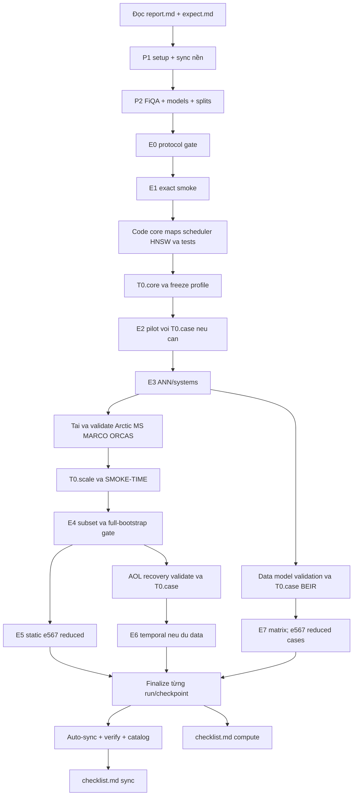

# Plan triển khai và nối toàn bộ thí nghiệm MixIndex

Trạng thái: **đặc tả đã viết; E4 đang chạy và E5-E7 chưa mở**. Target **server H100 80GB**. Agent làm lần lượt các phần dưới, giữ cập nhật [checklist gốc](../checklist.md); không tạo một plan khác thay cho plan này.

Điểm vào của agent là [codex/README.md](README.md). Luồng thực thi đã rà lại: **tải/validate inputs → E0/E1 correctness → code đầy đủ core → T0.core → freeze → E2/E3 → tải/validate scale inputs → T0.scale → E4 artifact/profile/hash verified → E5-E7 với `e567_scale_v2_50k`**. E6/E7 mở từng case sau T0 tương thích; không chờ tải hết mọi dữ liệu mới bắt đầu smoke.

## P0 — Bắt buộc hiểu paper và expected outputs trước khi code

1. **Đọc đầy đủ [report.md](../report.md)** để hiểu bài toán migration embedding, phạm vi paper, các kết quả placeholder, dữ liệu, pipeline, baseline và các quyết định đã khóa. Đặc biệt protocol chính là mục8.3 và15; mục9/10 định nghĩa so sánh/metric; mục11 định nghĩa E0–E7.
2. **Đọc đầy đủ [expect.md](../expect.md)** để biết mỗi E nhằm trả lời câu hỏi nào, so với ai, metric/endpoint nào quan trọng, artifact nào cần xuất, và cách đọc positive/negative/inconclusive results. Không thay việc đọc bằng bảng tóm tắt stage trong file này.
3. Đọc [constraints.md](constraints.md), [structure.md](structure.md), [contracts.md](contracts.md), [14_presetup_tuning.md](14_presetup_tuning.md) và [15_run_budget.md](15_run_budget.md), rồi kiểm file/code/checklist thực tế. Chưa có code thì bắt đầu M01; đã có code thì kiểm contract và kết quả test trước khi tiếp tục, không viết lại toàn bộ.
4. Trước khi code, agent phải diễn đạt ngắn được: map là regression không phải RL; `true` là h(d) trực tiếp; ORCAS là static graph không có event frequency; evaluator tách khỏi scheduler; primary static ở10% **accessed**, temporal tuần8 ở7% **scheduled**; E0–E7 có8 milestone.
5. Đọc và hiểu xong mới tick `READ` trong root checklist. Không cần tạo một Markdown “đã đọc”/Material Passport/evidence report riêng.

Nếu có mâu thuẫn: user correction hiện hành ưu tiên (H10080/server-only, tuning trước official). [M14](14_presetup_tuning.md) cụ thể hóa T0 và việc chọn lr từ grid validation đã có ở report15.3; report8.3/15 tiếp tục định nghĩa khoa học, budget/splits/metric. Không đổi primary để khớp illustrative curves hoặc vì ablation thắng trên test.

## P1 — Khung project, environment và đường sync trước run dài

Đọc M01, M10, M11, M12. Triển khai:

1. `pyproject.toml`, config registry/base, CLI skeleton, resolve paths/env và ignore caches/secrets.
2. `probe_hardware/effective_limits/probe_storage`, cost scopes; smoke torch trên chính H10080, pin dependency versions và hnswlib commit.
3. `progress.py` với root checklist atomic update, status schema và summary/config artifact writers tối thiểu.
4. Thin `run_single/finalize_run` và HF pipeline `collect_run_artifacts -> choose_upload_repo -> ensure_repo -> upload_bundle -> verify_remote_bundle -> auto_sync_experiment`. Làm một tiny safetensors/npz fixture và restore round-trip trước run thật.
5. Single-host queue tối thiểu1 slot lúc đầu, persistence/PID checks và `enqueue/status`; mở2 slots sau resource probes. Không cần code mọi E trước khi smoke.

Đầu ra P1: CLI/config import được, server limits đúng, không secret trong exports, tiny sync live verified nếu token có. Thiếu token/quota giữ sync pending, vẫn có thể viết/test modules độc lập; không coi mock là live upload, không tự đổi private→public.

Tick M01 khi setup test pass, M11 khi full sync/restore tests + live tiny pass; M09/M10/M13 có thể đang partial vì science runner chưa nối đủ. **Không tick module chỉ vì có skeleton.**

## P2 — Data và model inputs cho pilot

Đọc M02/M03/M04. Nối:

```text
dataset_spec(fiqa)
 -> download_dataset/verify_source_file
 -> prepare_dataset/build_document_store/group_queries
 -> build_static_splits (train/val + query roles)
resolve_model(MiniLM/MPNet) -> build_encoder -> smoke_encoder
 -> encode_corpus(g) + encode_query_pool
 -> PaidEmbeddingAccessor(live hoặc cached mode có nhãn)
```

Trước inference/tuning: pin/download MiniLM/MPNet, download FiQA, validate archive/checksum/full counts/schema/ID joins, preprocessing/grouping/splits, rồi smoke đúng document/query adapter. Raw/model downloads có thể overlap nếu CPU/disk đủ; không chạy hai writer trên cùng cache key. Corpus text title-newline-body, raw query representative và model-specific prompts khóa như docs; không chuyển sang passages/chunks. Các nhóm scale/E7 lặp lại đầy đủ bước này cho inputs của chính chúng.

E0 input manifest hoàn tất theo dataset stage; không chờ tải5 corpus lớn/AOL để chạy FiQA. Snapshot target đầy đủ có thể chuẩn bị riêng evaluator task, không expose handle cho scheduler. E0 compute gate kiểm config/environment/splits/accessor primitives và reference isolation; E0 sync là gate khác.

## P3 — Một vertical slice chạy E1 end-to-end

Chỉ code các phần cần để flow chạy đúng trước:

1. M05 `fit_op`, save/load và identity calibration.
2. M06 `ExactIndex` calibrated top11/tie-break, chưa cần ANN.
3. M07 bootstrap train/val/common OP cal proposals, paid accessor, random scheduler, backfill commit và checkpoints.
4. M08 full-new exact/old references, basic nDCG/ARR/Hit/NFR và output writers.
5. M09 `run_e0/run_e1`, finalize/sync/checklist hooks; M13 lệnh CLI thực sự gọi các hàm đó.
6. M12 tests cho cap/ID/leakage, known rotation, completion100% true và interrupted/resume prefix.

Chạy E1 FiQA subset2,000 IDs đã khóa; exact/random/OP, map seed17/traffic101. Lưu config→weights→metrics→checkpoint→HF verified→root checklist. Khi fail sửa và chạy lại diagnostic bằng run/config rõ; không chuyển sang scale để né bug.

P3.compute đạt khi input→search→select→backfill→evaluate→checkpoint/local restore hoạt động thật. HF sync/remote restore được tick riêng sau verify; pending upload không bắt chạy lại E1. Đây chưa phải bằng chứng greedy thắng. M05/M06/M07/M08 còn partial cho đến khi hoàn thiện các phần dưới.

## P3b — Hoàn thiện implementation cần cho T0 trước khi chạy E2

1. M05: LA/residual MLP, regions, float64 incremental statistics, regional/diagonal/global controls, OLS và radius đúng split roles.
2. M07: eager/lazy coverage tương đương, degree/read, full scheduling refresh, backfill/refit/remap, no-progress và resume.
3. M06: HNSW wrapper, same-ID update, read/write lock, save/load/ef và exact-vs-ANN fidelity. Code các phần này **trước T0**, không chờ tới E3 mới viết.
4. M08/M10/M12: output/statistics helpers, cost timers, resource/exclusive admission và numerical/leakage/resume tests. M14 nối các hàm `run_presetup`, selection, forecast, freeze/validate profile vào runner có sẵn.

## T0 — Pre-setup và tuning theo scope, có điểm dừng

Đọc đầy đủ [M14](14_presetup_tuning.md). Chạy `T0.core` trên FiQA/MiniLM–MPNet đã validate. Chọn lr trong `{1e-4,1e-3}` bằng P_val theo rule đã định; primary vẫn residual MLP. a/b từ cal-fit, r=P95 từ cal-check; Q_tune chỉ chọn HNSW fidelity. Giữ R/ridge/cadence/budget/seed/encoder semantics đã khóa. Không dùng test qrels/held-out ARR/nDCG hoặc future traffic để tuning.

T0 gồm MAP/CAL/INDEX/RUNTIME; dùng seed17/101, đo timing/repeats và chọn candidate khả thi trong grid hữu hạn. Dừng khi grid hoàn tất, correctness/local restore qua, có profile finite/feasible và forecast cho scope. Không tuning tiếp chỉ vì greedy chưa thắng. ANN_GATE_FAILED chặn ANN tasks; exact correctness đã qua vẫn có thể mở E2 exact. Missing calibration dùng fallback đã định, không làm giả r hay PASS0.99.

Freeze `configs/locked/tuning.lock.yaml` theo **profile dataset/model/map kind/search/runtime**; `state/tuning_manifest.json` là reference index. Mỗi run lưu policy hash + profile hash tương thích + config hash riêng. Đổi dataset/seed/scheduler đương nhiên đổi run hash; không bắt mọi E dùng một hash giống nhau. Các schedulers trong cùng comparison giữ settings chung; ablations chỉ override keys đã khai báo.

T0.core mở E2/E3; `T0.scale` được chạy tại P6 sau khi tải Arctic/MS MARCO/ORCAS, mở E4; T0.case của E6/E7 chạy sau khi inputs case đó sẵn sàng. Queue và worker kiểm đúng scoped dependency trước execution, không phụ thuộc một T0 tổng chưa rõ phạm vi. T0.compute tổng/core/scale và T0.sync trong checklist được theo dõi riêng; upload pending không chặn code hoặc compute hợp lệ khi local storage đủ.

## P4 — Hoàn thiện scientific pipeline và chạy E2

1. Chỉ chạy official sau T0.core/case compute và profile đã local-verified. Download/validate TREC, chạy `T0.case.trec-covid.minilm_mpnet` với đúng document pools; calibration/greedy N/A, search kế thừa có nhãn.
2. Dùng implementation P3b và selected hyperparameters; mỗi seed fit M0/regions/weights riêng rồi freeze M0/assignment sau bootstrap. Không dùng weights FiQA làm weights chung cho TREC.
3. Chạy E2 theo M15: FiQA mapping OP/LA/MLP × 3 map seeds với random (9), FiQA scheduler MLP × 4 schedulers × 3 map seeds với traffic101 (12), TREC mapping OP/LA/MLP tại map seed17 (3). Tổng 24 required cells; không mở traffic grid3×5 hoặc nhân toàn bộ mapping×scheduler. Native-limit vs matched-limit256 là sensitivity riêng, không lựa bằng test.
4. Regional refit mỗi5% N mới backfill; refresh toàn Q_schedule cho adaptive greedy, giữ bootstrap/budget/evaluation IDs chung giữa schedulers và lưu cả kết quả âm.

Dữ liệu/số học không đủ calibration thì dùng fallback đã khóa; quality test thấp **không** là trigger tự đổi primary. Giữ cả negative outputs. P4 correctness qua thì có thể đi E3 dù greedy chưa thắng có ý nghĩa.

## P5 — HNSW và systems E3

1. Xác minh implementation M06 đã qua T0; query và commit cùng index phải nhất quán epoch.
2. Dùng `(L,ef)` đã chọn trên Q_tune của case, kiểm lại fidelity bằng exact stored snapshot; gate ≥0.99 khác ARR-to-full-new. Giữ profile trong comparison; E3 là measurement/control, không mở vòng tuning theo test.
3. E3 controls fresh graph/same vectors, cadence1/5/10%, synchronized serving và failed-update save/load; tổng 6 tasks theo M15. Measure peak/RAM/bytes/stalls, không mở thêm seed matrix.
4. M10 hoàn thiện admission/reservations/exclusive mode. Systems workload16 clients, measured capacity và Poisson load theo M08; primary measurements **không chạy song song hoặc upload nặng**.

ANN gate không đạt: giữ exact result và diagnostic, chưa claim ANN full-scale. HNSW lock có stall thì đo, không sửa số thành0. Failed partial commit phải recover checkpoint nguyên vẹn.

## P6 — MS MARCO/ORCAS scale inputs và E4

1. Tải/pin Arctic pair, model smoke; tải MS MARCO **documents v1** đầy đủ + ORCAS; full ingest/count/schema/join/split validation trước inference. Giữ3.21M corpus, không chỉ nhóm clicked docs.
2. Chạy `T0.scale` theo M14: map lr từ đúng full-corpus train/val paid pools, runtime trên subset100k với tối đa10k scheduling groups. Bốn schedulers đến10% accessed; locked greedy tiếp tục25% để timing refit. Lưu SMOKE-TIME compute/sync và estimate sơ bộ; không tick E4 từ subset smoke này.
3. Dùng lại subset100k IDs đã freeze ở T0.scale; ORCAS normalized group split/remove judged-dev overlaps theo protocol, full study caps100k schedule/10k held-out. Probe subset không đọc held-out để tuning. Đây là static graph, không replay toàn10.4M queries.
4. Đo encoder batch/length, peak VRAM/RSS, refresh/gain memory, CPU throttling và I/O; scale query-count probe tới100k scheduling groups khi có. Sau subset feasible, encode old vectors/build **actual full bootstrap stored graph**, kiểm full-corpus Q_tune ANN fidelity và peak footprint trước E5. Reference ở gate dùng stored vectors, không unpaid targets. Cập nhật profile search chung và forecast bằng full-bootstrap measurements trước khi nhìn official test.
5. Config `live_encode` cost probes exclusive; `cached_access` quality pilots có thể co-schedule sau probes nhưng labels/cost modes tách rõ.

E4 gate đúng thì base policy mở E5 full-scale. Với `e567_scale_v2_50k`, không chạy lại E4: chỉ xác minh và reuse parent artifact/profile/hash rồi tạo child manifests 50k để mở E5-E7. Nếu resource không đủ, shard/stream hoặc giảm concurrency; không cleanup local trong phase này. Đổi primary semantics/token budget phải tạo variant, không lặng lẽ sửa. Mức128GiB RAM/16 CPU/1TB NVMe là recommendation/gate hoạch định trong report, không thay phép đo thực. Full-new evaluator cache được chuẩn bị trong task riêng, tính research cost và giữ cách ly.

## P7 — E5 primary static và extensions

Server execution áp dụng [16_e567_downscale.md](16_e567_downscale.md): giữ nguyên 12 cells và checkpoint semantics nhưng dùng MS MARCO child manifest 50k/ORCAS tối đa 5k groups. E4 không chạy lại; xác minh parent artifact/profile/hash rồi tạo reduced manifests trước E5. Primary ARR@10 vẫn ở 10% accessed; judged metrics có thể là `N/A_REDUCED_COVERAGE` nếu manifest không đủ coverage.

Đọc [15_run_budget.md](15_run_budget.md) trước khi expand task. Bản chạy mặc định là **12 primary cells**, gồm 4 scheduler × 3 map seed `{17,29,43}` × traffic seed `101`; không mở full 3×5 traffic grid. Mỗi cell chạy tiếp đến checkpoint bootstrap/5/10/25/50% accessed và 100% true trong cùng run ID. Có tối đa 4 E5 traffic-sensitivity cells (`random`, `greedy` × map seed17 × traffic `{103,109}`) nếu primary đã hợp lệ; chúng không chặn E5 và không được dùng để tune lại profile. Primary ARR@10 ở10% total accessed; judged-dev nDCG là secondary, cost measured/estimated phải có nhãn.

1. Chạy1 cell end-to-end kỹ thuật trước full matrix; không chọn scheduler dựa trên test để bỏ cells còn lại.
2. Queue tối đa2 compute jobs khi đủ memory/CPU/disk; đo live performance riêng exclusive. Co-scheduled timings không trở thành isolated performance claim.
3. Tại mỗi completed primary checkpoint/run: auto-sync ngay learned weights, state cần resume, metrics và source/config/inputs refs. M11 rollover bundle sang repo002… khi đạt **project policy**, không tăng account quota.
4. Required static checkpoints bootstrap,5/10/25/50% accessed và100% true theo report. Chạy primary10% trước, upload rồi enqueue continuation tasks cùng run ID/prefix; không tạo thêm100% scheduled cộng bootstrap. Có `E5.primary_done` để biết primary table đã đủ, nhưng E5.compute tổng chưa tick nếu required continuation còn thiếu. Cached-access được dùng cho quality matrix; live cost probes chạy riêng và không giả lookup time là GPU encode.
5. Aggregate paired contrasts3 baselines, CI/effect/Holm/seed variation. Không có significance cũng hoàn thành scientific run nếu gates đúng; không đổi primary khi kết quả âm.

## P8 — E6 temporal và E7 generalization

E6/E7 cũng dùng `e567_scale_v2_50k` nhưng không đổi số cell: E6 cap 50k recovered documents và 50k events/tuần trên chronology thật; E7 cap 50k documents và 500 queries cho NQ/HotpotQA/FEVER, còn FiQA/TREC-COVID chỉ reuse exact validated scope. Tất cả reduced manifests phải freeze/hash trước quality run; aggregate không được trộn với full-scale output.

Hai nhánh có thể chuẩn bị/chạy xen với E5 theo DAG và resource, không phải đợi E5 thắng:

- **E6:** recovery/validate AOL, pin Arctic; chạy T0.case trên document pools và query/history chỉ tuần1, freeze trước future evaluation. Rolling7 decisions→tuần8 at7% scheduled. Không available data ghi BLOCKED_DATA, root checkbox chưa xong; không synthetic replacement.
- **E7:** dùng ma trận compact tám case đại diện theo M15: MiniLM/MPNet trên FiQA và TREC-COVID; Arctic trên NQ và HotpotQA; Nomic trên FEVER và FiQA; BGE trên NQ và FEVER. Mỗi case chạy MLP với random/greedy ở map seed17 và traffic seed101 (16 cells), cộng OP+greedy trên bốn case cross-check (4 cells). Reuse FiQA/TREC outputs của E2 chỉ khi toàn bộ hash khớp. Đây là representative generalization pilot, không phải đủ20 dataset×model cases hoặc đủ3×5 seed grid; thiếu independent queries thì scheduler N/A/transfer có nhãn. Forecast bằng profile từng case, không lấy timing Arctic đại diện mọi model.
- Hoàn thiện published baselines M08: read source recipe, match paid budget hoặc tách published-protocol table, implement query-side/anchor/unpaired transforms đúng. Recipe thiếu thì explicit incomplete-baselines, không fake baseline.
- Matrix reuse chỉ khi exact config/data/model/split hashes khớp; mọi case âm giữ. Aggregate từng model/dataset, không chỉ grand mean.

E5/E6 có thể đổi thứ tự; E7 smaller cells có thể chạy khi E5 đợi network/inputs, nhưng không chen vào primary systems measurement. Stage hoàn thành không yêu cầu chứng minh method thắng mọi baseline, chỉ yêu cầu completed valid measurements và artifacts đã sync.

## DAG và run/sync lifecycle



E0–E4 và các T0 scope cũng qua finalize→sync dù diagram rút gọn. Official execution bị chặn nếu thiếu đúng T0 profile/input hash hoặc technical gate tương ứng. Enqueue task đang chờ dependency được phép; admission/worker không bypass. Dependency dùng **compute/correctness và local profile validation**; sync remote theo dõi riêng. Không cleanup local ở phase này, kể cả sau verified.

## Sau từng module/run agent phải làm

1. Reread output/config vừa tạo, chạy meaningful tests/gate tương ứng M12.
2. Update đúng marker Mxx/Eyy/run ID trong root checklist; compute và sync riêng.
3. Run/checkpoint closed→enqueue sync; kiểm verified receipt/catalog hoặc giữ pending reason. Không đợi xong tất cả experiments mới upload.
4. Tiếp tục eligible task khác nếu computation đủ, tối đa2. Missing process handle phải reconcile trước restart, không tạo duplicate runs.
5. Không ghi thêm nhiều provenance. Config+manifest+summary+result tables+compact IDs/events+weights+sync receipt đủ; chi tiết công thức ở source/docs, không lặp trong mỗi run.

## Điều kiện hoàn tất implementation và study

- M01–M14 đều có code/wiring và tests liên quan qua; CLI trong runbook chạy được thật; đúng T0 scope/profile đã freeze trước official evaluation.
- Các E được yêu cầu có đủ required cells, đúng endpoint/splits/budget/gates; missing/negative/inconclusive được ghi đúng trạng thái, không giả đã validate toàn paper.
- Learned weights/results/config/code/IDs đủ tái lập đã auto-sync verified, catalog tìm được parts trên các repos, restore/load test thật qua.
- Root checklist phản ánh artifacts/status thật, không phải ý định. Hiện mọi M/E checkboxes chưa chạy để `[ ]`.
- Cleanup local và chỉnh sửa paper chưa thuộc phase này. Dừng ở bộ results tái lập được và synced; không tự xóa hoặc thuê thêm compute.
