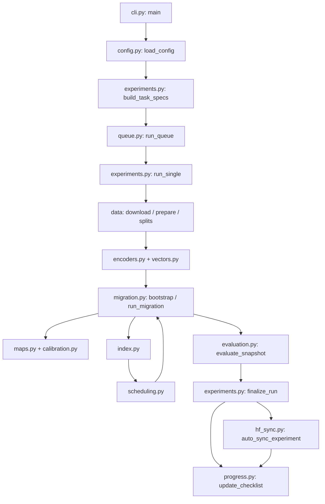

# Cấu trúc project cần triển khai

Đây là cấu trúc **đích**, chưa phải những file Python đang tồn tại. Repo hiện có PDF, report, expect và bộ Markdown hướng dẫn. Code chạy Linux server H100 80GB; mọi path resolve từ `PROJECT_ROOT`.

```text
paper-P2/
  README.md                  # mô tả ngắn và lệnh sử dụng sau khi CLI có thật
  main.pdf                   # nguồn paper; không sửa trong scope này
  report.md                  # protocol/review
  expect.md                  # hypotheses và cách đọc kết quả
  checklist.md               # tiến độ user theo dõi, một file duy nhất
  codex/                     # tài liệu đặc tả; đọc README.md tại đây
  pyproject.toml
  requirements.lock.txt      # exact versions sau smoke environment; không dùng latest lúc rerun
  .env.example               # tên biến và giá trị mẫu rỗng, không chứa credential
  .env                       # local-only HF_TOKEN và path; đã ignore, không upload
  configs/
    base.yaml
    datasets.yaml
    models.yaml
    experiments/e0.yaml ... e7.yaml
    experiments/t0.yaml      # scoped development prep; core/scale/case overrides
    locked/tuning.lock.yaml  # policy + immutable profiles, không copy fitted weights vào đây
    jobs.yaml                # danh sách TaskSpec + depends_on + resource request
  src/mixindex/
    __init__.py
    cli.py                   # argparse, gọi runner; không chứa công thức
    config.py                # YAML resolve/validate, dataclasses shared
    runtime.py               # env/hardware/probes + cost timers
    data/
      download.py            # HTTP streaming, checksum, archive extraction
      prepare.py             # BEIR/MS MARCO/ORCAS/AOL adapters
      splits.py              # query groups, pools, static/temporal splits
      store.py               # document lookup, IDs/rows, stream batches
    encoders.py              # checkpoint registry + model adapters
    vectors.py               # vector cache/shards + paid accessor/ledger
    maps.py                  # OP, LA, residual MLP + regional stats
    calibration.py           # positive OLS, identity fallback, r_score
    index.py                 # ExactIndex, HnswIndex, lock và search/rerank
    scheduling.py            # coverage/eager/lazy/random/degree/read/uncertainty
    migration.py             # bootstrap, batch commit, regional refit/remap
    evaluation.py            # full-new evaluator, qrels/ARR, gates/statistics
    baselines.py             # query-side adapters, dual-index, oracle diagnostics
    experiments.py          # T0/E0-E7 specs, bounded tuning, forecast, run_single/finalize
    queue.py                # single-host admission, subprocess, resume
    hf_sync.py              # bundle, upload, rollover, remote verify/restore
    progress.py             # atomic update root checklist; không chứa scientific logic
  tests/                     # meaningful numerical/leakage/resume tests
  data/
    raw/<dataset>/           # tải một lần; immutable inputs
    processed/<dataset>/
      documents.jsonl        # row order cố định, một document một dòng
      lookup.sqlite          # doc_id/row/byte_offset; query grouping nếu corpus lớn
      doc_ids.txt
      queries.parquet
      qrels.parquet
      traffic.parquet        # edges hoặc events; không giả frequency cho ORCAS
      splits/                # ID arrays/Parquet và temporal boundaries
      manifest.json
  cache/
    models/                  # HF snapshot cache và models.lock.json
    vectors/<key>/           # immutable old/query vectors; key theo inputs + adapter
    evaluator/<key>/         # full-new target cache, evaluator/accessor ownership
  runs/<run_id>/
    config.lock.json
    summary.json
    metrics.parquet
    retrieval.trec.gz
    events.jsonl
    accessed_ids.npz
    checkpoints/
    artifact_manifest.json
    sync.json
    stdout.log
    timing.json              # T0 phase measurements, khi có benchmark
    estimate.json            # T0/E4 forecast: measured/estimated/unmeasured components
  results/                   # aggregate tables/plots từ completed runs
  state/
    environment.json
    throughput_probe.json
    storage_manifest.json
    tuning_manifest.json     # index profile/hash/T0 run refs; không duplicate metrics
    tasks.json               # một queue state, không database/service
    hf_repos.json            # một registry repo/parts/receipts
  staging/                   # immutable bundles đang upload; không clone whole project
```

`hardware.json` được nhắc ở report được triển khai bằng section `hardware` trong `state/environment.json`; CLI `probe` có thể export alias `state/hardware.json` nếu công cụ khác cần, nhưng không duy trì hai nguồn cập nhật riêng. `provenance.json` của các ví dụ cũ được gộp vào config/manifest/summary để tránh duplicate.

## Luồng nối các file code



## Nguyên tắc lưu và chia sẻ

- `data/raw`/processed và model snapshots được chia sẻ **read-only** giữa jobs sau khi prepare xong; writer dùng temp path rồi rename, cache-key lock tránh ghi trùng.
- Mỗi run có fidelity array, mapped/true vectors, HNSW graph và RNG riêng. Không có global mutable index dùng chung hai schedulers.
- Tuning policy dùng chung; selected profiles có scope theo inputs/case. Fitted M0/regions/calibration và run config hash vẫn riêng từng seed/method. Thêm profile mới không sửa profile đã freeze.
- Vector float32 chia shard khoảng 1GiB là default vận hành có thể điều chỉnh; metadata lưu dtype/shape/row range. Không tạo một file/một document.
- Gói HF chứa learned states và inputs cần tái lập bằng reference, không tự sao chép mọi vector/raw dataset. Các index/snapshot đã dùng cho measurement quan trọng có thể lưu làm artifact lớn và chia part.
- Khi project phát triển, sửa cây ở file này ngắn gọn; không tạo bản mô tả kiến trúc thứ hai chỉ để kể lịch sử.
