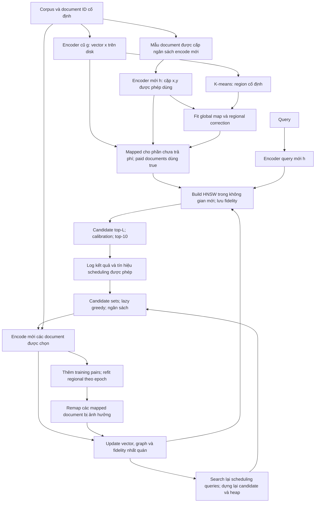

# Review MixIndex và kế hoạch triển khai thí nghiệm

Ngày đánh giá: **20/10/2026**, múi giờ Asia/Saigon. Tài liệu: `main.pdf`, 22 trang, tên **MixIndex: Mixed-Fidelity Vector Indexes with Traffic-Driven Backfill for Embedding-Model Migration**.

## Material Passport

| Trường | Giá trị |
|---|---|
| Origin Skill / Mode | academic-research-suite / experiment planning và validation bằng tài liệu |
| Origin Date | 2026-10-20 |
| Version Label | mixindex_experiment_review_v3_a100_scale |
| Verification Status | **ANALYZED; NOT REPRODUCED** |
| Content Hash của PDF | SHA256 `68c21fe32fc4b311a63048721729eccd215cac1280e556333218aa09ba3e8339` |
| Upstream Dependencies | PDF được cung cấp; inventory workspace; nguồn công khai chính thức liên kết trong báo cáo |
| Experiment provenance | Chưa có run thực nghiệm retrieval/training nào được cung cấp hoặc thực hiện trong lần review này |
| Phạm vi | Đọc paper, kiểm tra bằng chứng, phản biện độc lập và phản biện chéo; cập nhật protocol và tự chốt các lựa chọn kỹ thuật theo yêu cầu; chưa chỉnh sửa paper hoặc chạy thí nghiệm |

**Cách đọc mức xác minh:** “xác nhận từ PDF” là nội dung thực sự có trong bản thảo; “đối chiếu nguồn” là metadata/tài liệu công khai đã đọc; “suy ra” là tính toán hoặc phân tích của reviewer; “đề xuất” là lựa chọn cho thí nghiệm sắp tới. Metadata công khai không thay cho việc tải file, kiểm checksum và đếm lại dữ liệu.

**Cập nhật quyết định ngày 20/10/2026:** đã rà toàn bộ báo cáo và ảnh bảng D1–D17 được cung cấp. Các lựa chọn còn mở đã được chốt tại **mục 15**, kèm trạng thái từng issue, công thức, cấu hình và điều kiện kiểm tra. “Đã chốt thiết kế” không có nghĩa “đã chạy đạt”. Những biến thể trong các mục review được giữ để giải thích/ablation; **protocol chính dùng mục 8.3 và mục 15**. Target thực thi chính được người dùng xác nhận là **server H100 80GB**. Inventory H100-MIG được dán ngày 20/10 là một môi trường container khác và được ghi riêng, không được dùng thay cho hardware manifest của server H100.

**Bổ sung thứ tự setup theo yêu cầu mới:** trước official E2–E7, validate inputs và chạy T0 theo từng scope để chọn lr trên validation trong grid đã có tại15.3, chọn search trên Q_tune, đo runtime rồi freeze profile. Quy tắc chi tiết và điểm dừng ở [codex/14_presetup_tuning.md](codex/14_presetup_tuning.md), thứ tự tại [codex/plan.md](codex/plan.md). `lr=1e-3` dưới đây là default/reference, selected lr phải được ghi trước test. T0 không yêu cầu method thắng và không thay đổi ngân sách/splits/primary residual MLP. T0.core không chờ Arctic/AOL/E7; scale/case mới có readiness riêng. Tuning/implementation/measurements vẫn chưa chạy.

## 1. Kết luận và thứ tự việc cần làm

**Đây là một thiết kế nghiên cứu có thể triển khai, nhưng hiện chưa có bằng chứng thực nghiệm chứng minh hiệu quả.** Abstract trang 1, cuối Introduction trang 3, phần setup trang 12 và toàn Section 6 trang 15–19 đều nói các con số là placeholder, thí nghiệm chưa chạy. Vì vậy, không được dùng các mức 98.6%, 89% tiết kiệm, 1.9 GPU-hour, p99 2.9 ms hay các đường cong hiện tại để kết luận MixIndex tốt hơn baseline.

Thứ tự triển khai đã chốt trước khi chạy lớn:

1. **Chốt lại ý nghĩa traffic trên ORCAS.** Dataset này không công bố số lần phát sinh truy vấn/click; đếm số dòng theo query chỉ cho số liên kết với document. Dùng ORCAS để kiểm tra trên đồ thị click tĩnh; dùng AOL-IA để kiểm tra tần suất và thời gian thực sự.
2. **Xây pipeline nhỏ có oracle cách ly và sổ chi phí encoder.** Mọi document được encode bằng model mới cho map, validation, calibration hoặc backfill đều phải được ghi nhận. Full-rebuild embeddings chỉ được evaluator đọc.
3. **Đo chất lượng với exact search trước.** Sau đó mới đưa HNSW vào để tách sai số mapping, calibration, candidate retrieval và cập nhật graph.
4. **Bổ sung các phần vận hành chưa được đặc tả:** lấy nhiều candidate trước calibration; điều kiện kết thúc scheduler; refit regional map; đồng bộ update/query; tính cả build index ban đầu.
5. **Chạy pilot FiQA + TREC-COVID với MiniLM → MPNet**, rồi mở rộng mô hình và corpus. Chưa nên chạy ngay toàn bộ cấu hình lớn của bản thảo.

Kết luận về tính “artificial”: **các outcome trong Section 6 là số minh họa được khai báo, không phải số đo**. Đây không phải bằng chứng gian lận. Các dataset và checkpoint được kiểm tra đều có nguồn thật; vấn đề chính là một số giả định sử dụng dữ liệu chưa đúng, cùng nhiều thành phần chưa được triển khai hoặc xác minh.

## 2. Paper làm gì, quy mô nào, nguyên lý ra sao?

### 2.1. Bài toán

Một hệ thống tìm kiếm đã có vector document do encoder cũ `g` tạo ra. Khi chuyển sang encoder mới `h`, query mới và vector document cũ không còn ở cùng không gian có ý nghĩa. Cách truyền thống là encode lại toàn bộ corpus và xây index mới, trong thời gian đó vẫn phải phục vụ tìm kiếm.

MixIndex đề xuất **map vector cũ sang không gian mới trước, rồi thay dần bằng vector do encoder mới tính trực tiếp từ văn bản**. Hai loại vector cùng nằm trong một index phục vụ truy vấn. Đây là nghiên cứu về **migration của dense retrieval/index**, không có bước sinh câu trả lời bằng LLM trong phương pháp chính.

### 2.2. Bốn thành phần chính

| Thành phần | Dữ liệu vào / kết quả | Vai trò |
|---|---|---|
| Global map `M0` | Các cặp vector cũ–mới của một mẫu document | Xấp xỉ không gian mới mà chưa encode lại mọi document |
| Regional map `M_R` | K-means trên vector cũ; các cặp đã có trong từng region | Sửa sai số mapping theo vùng; nhận thêm cặp khi backfill |
| Calibration | Score mapped so với score từ vector mới trên các cặp query–document được phép truy cập | Điều chỉnh score giữa hai loại representation |
| Scheduler + backfill | Candidate document, slack, liên kết click và trọng số query | Chọn document cần encode trước trong ngân sách giới hạn |

Ký hiệu `true` trong paper chỉ có nghĩa **vector được model mới encode trực tiếp**; nó không phải nhãn document đúng hoặc relevant.

### 2.3. Quy mô dự kiến trong PDF

- Bốn cặp model; năm collection BEIR; ba seed cho mapping; năm seed cho traffic.
- MS MARCO **document ranking v1** khoảng 3.21 triệu document để kiểm tra quy mô; ORCAS để có liên kết query–document.
- AOL-IA khoảng 1.53 triệu document để kiểm tra workload có timestamp.
- HNSW: `M=16`, `ef_construction=200`, `ef_search=100`, output `k=10`; batch backfill 1% corpus; 256 region.
- Model pretrained được giữ cố định. Phần cần fit là map/correction/calibration, không cần huấn luyện lại các encoder từ đầu.

Chỉ riêng năm BEIR × bốn cặp model đã có **20 trường hợp dataset–upgrade**, tương ứng 60 trường hợp có seed trước khi nhân với số phương pháp. Nếu một cấu hình có 10 phương pháp phải chạy trên đủ ba seed, sẽ có 600 lượt đánh giá phương pháp; đây là quy mô đầy đủ của paper, không phải lịch chạy mặc định. Lịch execution compact_v1 dùng 8 representative cases và được định nghĩa riêng ở mục15/M15. Nên cache embedding theo checkpoint và corpus để dùng lại.

## 3. Pipeline mô hình và vận hành cụ thể

Sơ đồ dưới thể hiện pipeline cần triển khai. Phần evaluator chạy riêng để không cung cấp thông tin tương lai cho scheduler.



### 3.1. Chuẩn bị dữ liệu và encoder

1. Giữ document ID gốc; chốt văn bản đầu vào, cách ghép title/body, tokenizer, prefix, pooling, chiều vector, normalize và truncation. Với MS MARCO, chốt một vector/document từ `title + '\n' + body` được truncate theo cấu hình đã khóa; báo cáo tỷ lệ document bị truncate. Nếu chuyển sang nhiều chunk, phải định nghĩa aggregation về document và làm lại đơn vị ngân sách/index, vì đó là thay đổi thiết kế.
2. Tạo vector cũ `x_d = normalize(g(document_d))`; lưu theo shard hoặc memory-map, cùng thứ tự ID và hash.
3. Chia trước các nhóm document dùng để train map, validation map và calibration; chia query scheduling, calibration, đánh giá theo protocol ở mục 8.
4. Encode model mới chỉ cho các document được cấp quyền. Có thể chuẩn bị đầy đủ vector mới ở kho evaluator để tiết kiệm việc lặp encoder, nhưng migration phải thông qua accessor kiểm quyền và ghi sổ; không được đọc toàn ma trận đó trong map/scheduler.

### 3.2. Fit map

- OP: chốt zero-padding old vector lên `d_new` rồi Procrustes; khi forward map chỉ giữ các cột ứng với input gốc. Không được cộng/trừ vector khác chiều một cách ngầm định.
- LA: chốt `U` có shape `(d_new,64)`, `V` có shape `(d_old,64)` và rectangular diagonal `D` shape `(d_new,d_old)`; công thức là `(UV^T + D)x + b`.
- Residual MLP: `W x + b + mlp(x)`, kích thước output của cả hai nhánh phải bằng chiều model mới. Đây là global-map default của setup, khác OP dùng trong hình minh họa.
- K-means trên vector cũ xác định region; `M_R(x) = A_R M0(x) + b_R`. Chốt primary dùng số region theo lượng fitting pairs tại mục 15.3, ridge `lambda=10`, fallback global nếu dưới 20 fitting pairs; `R=256` là nhánh đối chiếu cấu hình bản thảo.
- Validation phải lưu lỗi theo region và số pair/region. `r_R` là RMS vector error, không phải upper bound của mọi score.

### 3.3. Khởi tạo index và phục vụ query

Khởi tạo stored vector bằng `y_d` cho paid documents và `normalize(M_R(x_d))` cho phần còn mapped, rồi **build graph trong không gian mới**. Shadow mapped vectors của paid documents chỉ dùng cho diagnostics/calibration. Chiều khác nhau đòi index mới có dimension phù hợp; việc cuối cùng chỉ có một serving index không xóa chi phí bootstrap hoặc nhu cầu phục vụ bằng old index trong lúc bootstrap.

Mỗi query dùng `y_q = normalize(h(query))`. Lấy candidate `L > 10` từ index, tính raw inner product và fidelity, rồi score:

```text
mapped: calibrated_score = a_m * dot(y_q, z_d) + b_m
true:   calibrated_score = dot(y_q, y_d)
```

Chốt fit với `a_m >= 1e-6`; true class luôn có `(a,b)=(1,0)`. Fit suy biến dùng identity và log lý do theo mục 15.4. Chọn top-10 sau calibration và giữ thêm score rank 11 để xác định cutoff. Pilot dùng exact calibrated search; ANN bắt đầu `L=100, ef_search=200` rồi chọn bằng validation theo mục 15.5, không tự bảo đảm exact calibrated top-10.

### 3.4. Scheduling và backfill

Với query scheduling `q`, lấy những relevant-proxy document đã được trả về, có estimated slack trong `(r, 2r]`; đặt chúng vào `A(q)`. Tập query at-risk phải được định nghĩa đúng như Eq. (5)–(6). Greedy chọn document có marginal coverage lớn nhất:

```text
F(S) = sum_q w_q * 1[A(q) giao S khác rỗng]
```

Mỗi batch: encode văn bản bằng `h`, update đúng document ID, đổi fidelity sang `true`, cập nhật graph, thêm cặp hợp lệ vào regional statistics. Cứ thêm 5% corpus được backfill thì refit các regional map đã nhận pair mới và remap **toàn bộ phần còn mapped trong các region đó**. `M0` và region assignment giữ cố định. Sau mỗi batch, search lại toàn bộ query scheduling của run và dựng lại candidate/heap; chi tiết ở mục 15.6.

**Đã chốt xử lý kết thúc:** loại document đã true/đã chọn, cap batch theo ngân sách còn lại và checkpoint kế tiếp. Primary dùng greedy khi gain dương, rồi random không hoàn lại trong phần còn mapped để lấp batch; log riêng số document fallback. Nhánh `coverage_stop` dừng ngay khi hết gain dương chỉ là ablation. Batch rỗng kết thúc với reason code, không tiếp tục vòng lặp. Đây là lựa chọn triển khai bổ sung cho Algorithm 1.

### 3.5. Nguyên lý và giới hạn bảo đảm

Theorem A, Corollary B và Theorem C trang 9–12 có lập luận hợp lý trong phạm vi giả định đã ghi:

- Sai số score được chặn đồng đều và margin đủ lớn thì **tập** top-k được giữ. Điều này không bảo đảm thứ tự bên trong top-k giống hệt hoặc nDCG không đổi.
- Corollary B chặn dưới hit-rate trên nhóm query đủ điều kiện và weight đã normalize; không phải bảo đảm recall của từng relevant document.
- Coverage `F` cố định, weight không âm và budget theo số document cho greedy hệ số `1-1/e`. Refitting làm `F` đổi nên không suy ra một hệ số cho toàn bộ quá trình adaptive.

PDF đã thừa nhận giới hạn quantile radius, calibrated score và ANN. Review không phát hiện lỗi chứng minh của ba kết quả trên; việc cần làm là kiểm tra mức hữu ích thực tế của các giả định và heuristic.

## 4. Tình trạng artifact hiện tại

| Hạng mục | Kết quả kiểm tra trực tiếp workspace |
|---|---|
| Paper | `main.pdf`, 690,561 byte, 22 trang; đã trích text toàn bộ và xem hình/bảng quan trọng |
| README | Chỉ có dòng `# paper-P2` |
| File khác ban đầu | `.gitignore`, `LICENSE`, `.git` |
| Code chạy | Chưa có implementation, training/evaluation scripts hoặc experiment config |
| Dữ liệu/checkpoint | Chưa có trong workspace được kiểm tra |
| Bằng chứng số đo | Chưa có raw runfiles, logs, metrics, seed outputs, CI/bootstrap artifacts hoặc hardware benchmark |
| Git trước review | Ba file tracked: README, LICENSE, .gitignore; `main.pdf` là untracked |

Vì vậy đây là **review thiết kế và kế hoạch xây artifact**, chưa phải kiểm tra tái lập thành công. Một công cụ Poppler báo lỗi giải nén một số stream; đã dùng thêm PyMuPDF để trích được text của đủ 22 trang và render các trang cần kiểm tra. Không suy từ cảnh báo parser thành lỗi nghiên cứu.

## 5. Kiểm toán dữ liệu, tính artificial và những phần chưa hoàn chỉnh

`P0`: phải giải quyết trước lượt chạy chính. `P1`: phải có trước khi đưa ra kết luận chất lượng/chi phí. Các mức là ưu tiên của review, không phải kết quả đo.

| ID | Mức / vị trí PDF | Phát hiện và mức chắc chắn | Việc kiểm chứng hoặc khắc phục |
|---|---|---|---|
| D1 | P0; abstract, §6, Tables 1–4, Figs. 1–3 | **Xác nhận:** các outcome là placeholder. Không có measured ranking, saving, CI hoặc significance trong artifact hiện có | Mỗi kết quả mới phải có run ID, config, data/checkpoint hash, per-query output và đường dẫn log; không dùng placeholder làm target để tune |
| D2 | P0; Fig. 1, §3 setting, §5 traffic | **Sai khác ngữ nghĩa đã đối chiếu:** ORCAS không công bố event frequency/click count; query–document degree không phải số lần query được phát sinh | ORCAS primary dùng uniform query weights; degree proxy và synthetic workload là nhánh riêng; frequency/temporal claim dùng AOL-IA |
| D3 | P0; §3.2–3.3, §5 p13–14 | **Thiếu đặc tả:** fitting pairs, region held-outs, 2k calibration pairs đều cần `y_d`, trong khi quyền truy cập chỉ nêu n0 và backfill | Khóa split và ledger hợp các document đã encode; không đọc oracle để tạo calibration miễn phí |
| D4 | P0; §3.3, §5 index | **Rủi ro cấu trúc:** rerank/calibrate raw top-10 không thể đưa trở lại document đã bị loại khỏi pool | Oversample; đo recall của candidate pool so với exact calibrated ranking; lấy cutoff k+1 |
| D5 | P0; Algorithm 1 | **Thiếu điều kiện kết thúc:** heap có thể hết trước fN; batch rỗng không tăng S | Stop/fallback rõ ràng; dedup và cap ngân sách; log lý do dừng |
| D6 | P0; §5 latency, Table 4 | **Đối chiếu implementation:** hnswlib công khai không hỗ trợ gọi `add_items` đồng thời `knn_query` theo contract thread-safety | Pin version; thiết kế lock hoặc primitive khác; đo stall, queue, error và downtime thật |
| D7 | P1; Eq. (1), Table 4 | **Thiếu chi phí bootstrap:** phải map corpus và build mapped-space graph; Table 4 chủ yếu tính fitting + overwrite cho MixIndex | Đo từ lúc bắt đầu migration đến first serve, steady serve và hoàn tất budget; tính peak RAM/disk cả bootstrap |
| D8 | P1; Eq. (2), Algorithm 1, Table 4 | **Suy ra rủi ro:** refit rồi remap toàn region mỗi batch có thể gây nhiều lần ghi vector, rất khác field amplification 1.6 | Ghi touched regions, remapped count, direct writes, graph repairs, wall time theo batch; sweep refit cadence |
| D9 | P1; Eq. (2), n0/R | **Rủi ro cần đo:** 10k train pairs / 256 region trung bình khoảng 39/region, nhưng mỗi affine matrix 1024×1024 | Không kết luận chắc overfit; đo held-out error, effective sample, fallback; so diagonal/low-rank và global-only |
| D10 | P1; Eq. (4)–(5), §4 | **Đã được PDF giới hạn:** radius 95th percentile không phải bound mọi document; residual raw chưa đồng nhất calibrated residual | Fit calibration và đánh giá residual trên phần tách biệt; lưu violation rate theo epoch/fidelity/margin; không gọi empirical quantile là certificate |
| D11 | P1; Eq. (5) | **Giới hạn candidate:** relevant document đã rơi khỏi served top-k không được scheduler hiện tại chọn trực tiếp để cứu | Đo tỷ lệ clicked/relevant docs nằm ngoài pool; ablate top-L/extra clicked candidate/exploration, cùng ngân sách |
| D12 | P1; §5 baselines, Table 2 | **Confound thiết kế:** random dual-index và greedy mixed-index thay đổi cả hệ thống lẫn thứ tự backfill | So schedulers trên cùng mixed-index loop trước; dual-index là so sánh cấp hệ thống riêng |
| D13 | P1; §5 models | **Thiếu đặc tả:** prompt/pooling/truncation, map khác chiều, seed partition và calibration updates chưa khóa | Model adapters và config có assertion; kiểm smoke outputs trước khi encode corpus |
| D14 | P1; §5 datasets | **Chưa xác minh trên file:** 2,073 overlap query là placeholder; AOL eight-week window chưa nêu dates/filter | Tính overlap sau normalize theo quy tắc khóa trước; xuất split IDs và date boundaries; thống kê join/missing |
| D15 | P1; p4, p20, ref. [1] | **Sai phạm vi trích dẫn:** nguồn Embedding Surgery kiểm tra FAISS Flat/IVF/HNSW, không hỗ trợ câu gán nghiên cứu DiskANN cho tài liệu đó | Trong kế hoạch chỉ triển khai HNSW; ghi issue trích dẫn để xử lý khi sửa paper sau |
| D16 | P1; Metrics, Table 4 | **Chưa định nghĩa đủ:** NFR denominator, AUC interval, reference exact/ANN, latency có query encoding hay không | Khóa công thức tại mục 10; báo tuyệt đối và retained; tách index-only với end-to-end |
| D17 | P1; Hardware p15 | **Metadata chưa khớp:** 68GB unified memory chưa khớp các mức RAM M5 Max công khai; Windows/P2000 chỉ là kế hoạch pilot; target thực thi là server H100 80GB, còn inventory H100-MIG là môi trường khác | Ghi hardware thực tế của server H100 tại mục12; giữ H100-MIG như inventory không gắn với primary run |
| D18 | P0; adaptive lazy greedy | **Thiếu invariant:** sau khi A(q), r hoặc calibration đổi, gain cũ trong heap không còn chắc là upper bound | Dựng lại heap sau mỗi batch; chỉ dùng lazy updates trong một batch có F cố định |
| D19 | P0; refresh affected queries | **Thiếu đặc tả:** query chưa từng trả về document vừa remap vẫn có thể đổi top-k/cutoff | Primary search lại toàn bộ query scheduling đã khai báo của run sau mỗi batch; tính cả chi phí này |
| D20 | P1; sufficient statistics | **Phụ thuộc chưa khóa:** đổi M0 làm mọi u_d trong regional statistics thay đổi | Primary đóng băng M0; chỉ refit regional. Global-refit là ablation riêng, phải dựng lại statistics và remap toàn phần mapped |

Nguồn cho D2: [paper ORCAS, §3–4](https://arxiv.org/html/2006.05324v1) phân biệt việc giữ một query–URL connection với việc giữ popularity; [schema chính thức](https://github.com/microsoft/msmarco/blob/master/ORCAS.md) chỉ có qid/query/did/url. Degree có thể là proxy popularity nhưng không khôi phục được số lần click.

Nguồn cho D6: [contract hnswlib](https://github.com/nmslib/hnswlib) nêu update/query không thread-safe với nhau. Kết luận này áp dụng cho API implementation được kiểm tra, không có nghĩa mọi HNSW đều không thể phục vụ cập nhật đồng thời.

Nguồn cho D15: [Embedding Surgery bản v1](https://arxiv.org/html/2609.05110v1). Kết quả cho perturbation/localized updates không tự chứng minh được chất lượng khi đổi embedding model trên toàn corpus.

### 5.1. Hai tính toán cần đưa vào quyết định vận hành

**Write amplification.** Giả sử mỗi batch backfill 1% chạm mọi region và mỗi lần refit ghi lại toàn bộ document còn mapped. Sau 10 batch, phần remap bằng `(0.99 + 0.98 + ... + 0.90)N = 9.45N`, cộng `0.10N` direct writes, thành `9.55N`. Chia cho số direct backfill document `0.10N` cho **95.5 lần ghi/vector được backfill**. Đây là một scenario tính toán, **không phải amplification đã đo hoặc dự báo chắc chắn**; traffic tập trung, refit thưa hoặc cập nhật có chọn lọc có thể cho kết quả khác. Nó cho thấy vì sao cần đo thay vì dùng field 1.6.

**Memory regional mapping.** Với R=256, d1=1024, chỉ các ma trận `A_R` float32 đã cần khoảng **1.0 GiB**. Hai sufficient-statistics matrix augmented theo Eq. (2), nếu lưu float64, cần thêm khoảng **4.01 GiB**, chưa tính solver workspace. Số pair ít không làm ridge vô nghiệm do regularization, nhưng không đủ để mặc nhiên khẳng định generalization.

### 5.2. Kiểm tra nguồn và checkpoint: điều gì không bị phát hiện là sai?

Các kích thước bốn cặp model khớp metadata nguồn tại thời điểm review. Quy mô BEIR trong PDF cũng khớp bản chuẩn sau làm tròn. Không được gọi chúng là dữ liệu giả chỉ vì chưa tải về.

Đã xác minh sự tồn tại và metadata của năm tài liệu then chốt: [Embedding Surgery, 2609.05110](https://arxiv.org/abs/2609.05110), [Residual Reachability, 2609.23036](https://arxiv.org/abs/2609.23036), [Procrustes Bounds, 2510.13406](https://arxiv.org/abs/2510.13406), [Drift-Adapter, EMNLP 2025](https://aclanthology.org/2025.emnlp-main.805/), và [mini-vec2vec, 2510.02348](https://arxiv.org/abs/2510.02348). Đây là kiểm tra chọn lọc, chưa phải audit toàn bộ 41 references. Sự tồn tại của nguồn không xác minh kết quả MixIndex hoặc mọi diễn giải trong bản thảo.

## 6. Các dataset cần tải và thứ tự tải

### 6.1. Bắt buộc cho pilot và BEIR evaluation

Dùng **bản BEIR đã tiền xử lý**, gồm `corpus.jsonl`, `queries.jsonl`, `qrels/<split>.tsv`. Không tự thay bằng bản NQ/HotpotQA/FEVER gốc có đơn vị retrieval khác. Test counts dưới đây là mục tiêu đối chiếu nguồn; sau tải phải đếm lại file thực tế.

| Ưu tiên | Collection | Corpus chuẩn | Query test | Tải chính thức |
|---|---|---:|---:|---|
| 1 | FiQA-2018 (`fiqa`) | 57,638 | 648 | [fiqa.zip](https://public.ukp.informatik.tu-darmstadt.de/thakur/BEIR/datasets/fiqa.zip) |
| 2 | TREC-COVID (`trec-covid`) | 171,332 | 50 | [trec-covid.zip](https://public.ukp.informatik.tu-darmstadt.de/thakur/BEIR/datasets/trec-covid.zip) |
| 3 | Natural Questions (`nq`) | 2,681,468 | 3,452 | [nq.zip](https://public.ukp.informatik.tu-darmstadt.de/thakur/BEIR/datasets/nq.zip) |
| 4 | HotpotQA (`hotpotqa`) | 5,233,329 | 7,405 | [hotpotqa.zip](https://public.ukp.informatik.tu-darmstadt.de/thakur/BEIR/datasets/hotpotqa.zip) |
| 5 | FEVER (`fever`) | 5,416,568 | 6,666 | [fever.zip](https://public.ukp.informatik.tu-darmstadt.de/thakur/BEIR/datasets/fever.zip) |

Tổng năm corpus là **13,560,335 collection-document records**, tổng query test **18,221**; chưa deduplicate văn bản trùng giữa các collection. Registry: [BEIR chính thức](https://github.com/beir-cellar/beir); số đếm chi tiết đối chiếu [ir_datasets/BEIR](https://ir-datasets.com/beir.html), cùng các bản [NQ](https://huggingface.co/datasets/BeIR/nq), [HotpotQA](https://huggingface.co/datasets/BeIR/hotpotqa), [FEVER](https://huggingface.co/datasets/BeIR/fever), [TREC-COVID](https://huggingface.co/datasets/BeIR/trec-covid), [FiQA](https://huggingface.co/datasets/BeIR/fiqa). Nếu dùng Hugging Face, cần tải cả qrels tương ứng; corpus-only không đủ đánh giá. Riêng FEVER dev và test đều có 6,666 queries, nên khớp số query chưa đủ để xác nhận đúng split; metadata ghi test 7,937 và dev 8,079 qrel records.

Mỗi dataset có nguồn và điều khoản riêng; license code BEIR không tự cấp quyền cho mọi nội dung corpus. Manifest phải ghi URL, revision/ngày tải, checksum, split và license của bản tải thực tế. Với FEVER cần đặc biệt pin release do nguồn đã có cập nhật dữ liệu; không sao chép checksum từ note cũ.

### 6.2. Bắt buộc cho scale study: MS MARCO Documents v1 + ORCAS

**MS MARCO phải là document ranking v1, không phải passage ranking/BEIR `msmarco`.** Nguồn document chuẩn có **3,213,835 document**, **5,193 dev queries**, **5,478 dev qrel records**. Passage corpus có 8,841,823 passage và ID khác. [Registry và bảng file của Microsoft](https://microsoft.github.io/msmarco/Datasets.html).

Tải tối thiểu:

| File | Vai trò | Link |
|---|---|---|
| `msmarco-docs.tsv.gz` | docid, URL, title, body; bảng nguồn mô tả corpus khoảng 22 GB dạng TSV | [Corpus documents](https://msmarco.z22.web.core.windows.net/msmarcoranking/msmarco-docs.tsv.gz) |
| `msmarco-docdev-queries.tsv.gz` | Query judged dev | [Dev queries](https://msmarco.z22.web.core.windows.net/msmarcoranking/msmarco-docdev-queries.tsv.gz) |
| `msmarco-docdev-qrels.tsv.gz` | Relevance labels dev | [Dev qrels](https://msmarco.z22.web.core.windows.net/msmarcoranking/msmarco-docdev-qrels.tsv.gz) |
| `orcas.tsv.gz` | Query–document edges để scheduling và static held-out comparison | [ORCAS edges](https://msmarco.z22.web.core.windows.net/msmarcoranking/orcas.tsv.gz) |

ORCAS công bố **18,823,602 records**, **10,405,342 queries**, phủ khoảng 1.4 triệu document; file edges nén khoảng **330 MB**. Schema và checksum nguồn có tại [ORCAS registry](https://github.com/microsoft/msmarco/blob/master/ORCAS.md). Không cần tải file `orcas-doctrain-top100.gz` khoảng 10.7 GB cho pipeline chính nếu không dùng baseline phụ thuộc candidate file đó.

Giữ đủ corpus document 3.21M để đánh giá scale; không thu corpus còn 1.4M chỉ vì đó là nhóm có click. Kiểm join doc IDs và báo missing/deduplicated edges. Loại query-string overlap với dev trước khi split scheduling/held-out, không dùng placeholder 2,073 làm kết quả.

Các link trên đã được đối chiếu registry; **chưa tải file hoặc kiểm checksum/khả năng tải trọn vẹn trong phiên này**. Điều khoản MS MARCO/ORCAS cho nghiên cứu phi thương mại được nêu tại [trang dataset](https://microsoft.github.io/msmarco/Datasets.html); ghi lại điều khoản cùng release manifest.

### 6.3. Cần cho kết luận về temporal traffic: AOL-IA

Theo [metadata `ir_datasets/aol-ia`](https://ir-datasets.com/aol-ia.html): 1,525,586 document, 9,966,939 normalized queries, 19,442,629 clicked qrels và 36,389,567 qlog entries. `qlogs` có thời gian; `qrels` là click proxy, không phải bộ relevance judgments độc lập.

Hướng dẫn AOL-IA chính thức đã đối chiếu yêu cầu khôi phục document bằng [aolia-tools](https://github.com/terrierteam/aolia-tools) từ Internet Archive; review chưa xác minh một corpus ZIP tải sẵn. Cần snapshot quá trình download/extraction, danh sách URL thất bại và corpus thực sự phục hồi. Ước lượng khoảng hai ngày trong tài liệu tác giả không phải cam kết thời gian hiện tại.

Chốt tám lát bảy ngày liên tiếp, bắt đầu lúc 00:00 của ngày sớm nhất có timestamp hợp lệ trong release đã pin; xuất ngày thực tế trước khi xem quality, không chọn lại khoảng có kết quả tốt. Giữ quy ước timezone của nguồn, ghi rõ nếu nguồn không chỉ định. Ở tuần t, chỉ đọc sự kiện đến cuối tuần t; đánh giá tuần t+1. Đếm query **events**, tránh biến nhiều clicked items trong cùng event thành nhiều lần query. AOL-IA có corpus/ID riêng; không join click của AOL sang MS MARCO bằng ID. Quy tắc coverage và ngân sách temporal ở mục 15.7.

Giữ log ở máy/compute được phép sử dụng, xuất thống kê tổng hợp và run IDs phục vụ nghiên cứu; khả năng tải và phân phối lại nội dung cần theo điều khoản của nguồn.

### 6.4. Dataset tùy chọn và dữ liệu artificial được phép

- **TREC Deep Learning document judgments** có thể bổ sung kiểm tra với judgments dày hơn trên corpus MS MARCO phù hợp; không thay dev chính hoặc trộn document/passage IDs. [Nguồn TREC DL](https://microsoft.github.io/msmarco/TREC-Deep-Learning-2020).
- **TripClick** chỉ là nhánh mở rộng nếu AOL-IA không khả dụng hoặc cần thêm domain. Nó được nhắc ở related work, không phải dataset bắt buộc trong protocol hiện tại. [Trang tác giả](https://tripdatabase.github.io/tripclick/).
- **Synthetic workload** uniform/Zipf, controlled shift và toy score perturbation dùng được cho stress/sensitivity. Phải lưu seed/generator và gắn nhãn `synthetic`; không dùng chúng để khẳng định đã kiểm tra traffic thực tế hoặc thay số đo thật bằng đường cong dựng tay.
- Không cần tải toàn bộ MTEB, dataset pretraining encoder, hoặc hàng trăm GB MS MARCO training triples để thực hiện phương pháp này.

## 7. Checkpoint cần tải và quy tắc encode

| Cặp nâng cấp | Encoder cũ | Encoder mới | Chiều |
|---|---|---|---|
| Nomic | [nomic-ai/nomic-embed-text-v1](https://huggingface.co/nomic-ai/nomic-embed-text-v1) | [nomic-ai/nomic-embed-text-v1.5](https://huggingface.co/nomic-ai/nomic-embed-text-v1.5) | 768 → 768 |
| Arctic | [Snowflake/snowflake-arctic-embed-l](https://huggingface.co/Snowflake/snowflake-arctic-embed-l) | [Snowflake/snowflake-arctic-embed-l-v2.0](https://huggingface.co/Snowflake/snowflake-arctic-embed-l-v2.0) | 1024 → 1024 |
| BGE | [BAAI/bge-base-en-v1.5](https://huggingface.co/BAAI/bge-base-en-v1.5) | [BAAI/bge-m3](https://huggingface.co/BAAI/bge-m3) | 768 → 1024 |
| Sentence Transformers | [sentence-transformers/all-MiniLM-L6-v2](https://huggingface.co/sentence-transformers/all-MiniLM-L6-v2) | [sentence-transformers/all-mpnet-base-v2](https://huggingface.co/sentence-transformers/all-mpnet-base-v2) | 384 → 768 |

**Tải hai checkpoint MiniLM/MPNet trước cho pilot; chưa cần tải cả tám ngay.** Khi chạy chính, pin commit/revision, tokenizer, pooling, inference dtype và các dependency. Model card metadata đã đối chiếu; chưa có inference smoke test xác minh output từ bản checkpoint tải thực tế.

Các adapter phải tuân model card:

- Nomic dùng `search_query: ` và `search_document: `; v1.5 dùng đủ 768 chiều trong protocol này, không ngầm giảm chiều Matryoshka.
- Arctic v1 dùng query instruction của checkpoint; v2 có `prompt_name="query"`/prefix `query: ` và CLS pooling theo hướng dẫn. Không dùng chung prefix của v1 cho v2 chỉ vì cùng family.
- BGE-base có query instruction cho retrieval; BGE-M3 không cần instruction như BGE v1.5. Chỉ lấy **dense vector**, không bật sparse/ColBERT rồi gọi đó là cùng hệ dense migration.
- MiniLM/MPNet dùng tokenizer, pooling và max sequence length của checkpoint; không tự đổi toàn bộ thành CLS pooling.

Với long document, lựa chọn truncation có thể làm model mới tốt hơn/kém hơn vì lượng văn bản nhìn thấy, không riêng mapping. Giữ policy cố định trong mỗi cặp, ghi native limits và làm sensitivity theo token budget nếu cần. Không thể giả định mọi “upgrade” tăng relevance: cần đo absolute old/new nDCG trước khi phân tích retained quality.

## 8. Protocol vận hành đã chốt trước khi chạy

Các quyết định trong phần này đã **chốt cho implementation tiếp theo** theo yêu cầu tự lựa chọn của người dùng; chưa phải config đã chạy hoặc sửa paper. Mục 15 ghi lý do, fallback và cách kiểm chứng.

### 8.1. Ngân sách encoder và cách ly evaluator

Định nghĩa ba trục khác nhau:

```text
f_scheduled = số document backfill theo lịch / N
f_accessed  = số document duy nhất migration đã đọc embedding mới / N
f_true      = số document đang phục vụ bằng vector mới trực tiếp / N

paid_new_docs = union(P_train, P_validation, D_calibration, S_backfill)
# Khi baseline dùng anchors hoặc unpaired vectors, thêm:
paid_new_docs_baseline = union(paid_new_docs, D_anchors, D_unpaired_new)
```

Tính cả token, encoder wall time và lần encode lại ngoài số unique document. Primary chốt `n_train=min(10000,ceil(0.02N))`, `n_val=min(2000,ceil(0.005N))`; hai nhóm document cal-fit/cal-check có cap riêng `min(1000,ceil(0.005N))` mỗi nhóm. Các nhóm document đôi một tách biệt. Nhánh `paper_matched` dùng 10k train và R256 để đối chiếu bản thảo, báo chi phí held-outs riêng. Không giấu held-outs trong n0 nếu n0 đang được định nghĩa là số pair train.

Tập calibration tối đa 2,000 **query–document pairs**, 1,000 cal-fit và 1,000 cal-check, không nhất thiết cần 2,000 document khác nhau. Chốt tách cả query groups và document pools giữa fit/check; query calibration cũng tách scheduling, tuning và evaluation. Lấy candidate gần cutoff từ calibration queries phía training, yêu cầu encoder qua budget accessor và dừng ở cap unique document; nếu không đủ pair thì báo số thực tế, không đọc oracle để bù. Các pool được khóa sau bootstrap, không nhập vào fit map về sau. Sau mỗi regional epoch tính lại shadow mapped scores trên chính các pair hợp lệ này, dù fidelity phục vụ là true. Điều kiện đủ dữ liệu và identity fallback ở mục 15.4.

**Primary phục vụ mọi document đã trả tiền encode dưới dạng true ngay khi bootstrap hoàn tất**, gồm fitting, validation và calibration documents. Diagnostic `all_mapped_start` cố ý phục vụ chúng mapped để kiểm tra tính đơn điệu calibration; đây là nhánh riêng, vẫn tính phí encode. Riêng cấu hình paper-matched 10,000 fitting document đã chiếm **17.35% corpus FiQA** trước validation/calibration; vì vậy 0% scheduled không có nghĩa gần 0% encoder cost. Primary FiQA có cap bootstrap 2,020 document, khoảng 3.50%; số thực tế phụ thuộc calibration pool.

Với nhánh phục vụ paid pairs dưới dạng true ngay từ đầu, `f_scheduled` tối đa chỉ là phần corpus còn mapped ban đầu; không đòi thêm 100% corpus scheduled nữa. Mốc hoàn tất là **f_true = 100%**, exact scores khớp full-new reference. Với diagnostic khởi tạo toàn mapped, có thể dùng đủ trục f_scheduled từ 0% đến 100%. Mọi bảng/curve phải ghi rõ nhánh nào.

Evaluator giữ toàn bộ `Y_full`, full-rebuild rankings và judged test labels. Migration không được đọc chúng để fit, chọn batch, chọn hyperparameters hoặc quyết định dừng. Hindsight oracle chạy trong evaluator, đặt nhãn oracle rõ ràng. Chi phí dựng reference/full embeddings cho nghiên cứu ghi riêng; không cộng nó vào migration cost, cũng không dùng nó miễn phí để migration biết document tương lai.

Chốt hai execution modes: `cached_access` dùng accessor trên target cache để so quality, vẫn tính unique IDs/tokens nhưng **không gọi thời gian lookup là GPU encode time**; `live_encode` thật sự gọi h cho từng document được cấp quyền và dùng để báo chi phí/latency migration đo được. Nếu ngoại suy cost từ encoder benchmark cho cached runs thì ghi rõ `estimated`, không `measured`. Cả hai mode đều giữ evaluator isolation.

### 8.2. Query splits và traffic weights

| Nguồn | Query dùng cho scheduling | Evaluation | Weight chính |
|---|---|---|---|
| BEIR | Train/dev queries nếu có; không dùng test qrels để chọn backfill | Test queries + qrels cố định | Uniform; synthetic traffic chỉ ở stress test |
| ORCAS | Nhóm query strings sau loại overlap với judged dev; split50/50 cố định bằng seed20261020; traffic seed lấy sample trong scheduling half | Half held-out với eval sample cố định cho ARR; MS MARCO judged dev để đo nDCG | **Uniform per unique query** |
| ORCAS sensitivity | Cùng split | Cùng evaluator | Degree proxy hoặc synthetic Zipf, ghi nhãn riêng |
| AOL-IA | Events có time ≤ cutoff tuần t | Events tuần t+1 | Tần suất query events trong quá khứ cho scheduling; distribution tuần tương lai cho evaluation |

**Trường hợp không có train/dev queries:** TREC-COVID chỉ có 50 test queries trong benchmark này. Primary trên bộ này dùng map fitting từ document, random backfill, calibration tắt và greedy N/A. Auxiliary query/calibration pool là nhánh bổ sung có provenance, không phải dependency của primary. Không dùng 50 test queries hoặc qrels để tạo scheduler gains/tune. Muốn kiểm greedy trên collection này phải dùng auxiliary/pseudoqueries đã khóa trước và ghi rõ nguồn/synthetic; không coi đó là real-traffic evidence. Mapping-only Q1 không cần query-log của collection.

Chuẩn hóa query nhất quán trước khi nhóm/split; lưu rule và IDs. Group duplicate strings cùng phía. Query IDs khác namespace không chứng minh text disjoint. Shared clicked document giữa ORCAS hai phía không tự là leakage: corpus là tài nguyên chung trong migration. Cần báo overlap document và tách rõ warm-document generalization; không tuyên bố đã test unseen-document nếu không có split bổ sung.

Random split query strings trong ORCAS không phải temporal replay và không kiểm tra hot query lặp lại theo thời gian. Không xây synthetic timestamp rồi gọi đó là log thật.

### 8.3. Config chính và sensitivity

| Hạng mục | Cấu hình primary đã chốt | Sensitivity đã định trước |
|---|---|---|
| Global map | Residual MLP hidden256; Adam default lr1e-3, selected lr từ T0 grid1e-4/1e-3 trên P_val; batch256, tối đa50 epoch, patience5; M0 freeze sau bootstrap | OP, LA rank64 có cùng validation-grid effort; không chọn map kind theo test |
| Region | Eq. (2) full affine, lambda10, nmin20; R theo lượng train tại 15.3; region assignment cố định | R256 paper-matched; diagonal; global-only; lambda1/10/100 |
| Fitting pairs | Train2% cap10k; validation0.5% cap2k; cal-fit/check mỗi nhóm0.5% cap1k document | Paper-matched10k; mọi phương pháp nhận cùng quyền truy cập ban đầu |
| Calibration | OLS scale dương; true identity; fit/check tách cả query/document; `r_score=P95` calibrated residual check | Identity; P90/P99; `r_vec_region` chỉ diagnostic, chưa dùng r_score_region |
| Candidate | Exact pilot; ANN khởi điểm k10/L100/ef200; chọn cặp nhỏ nhất đạt validation gate tại15.5 | L50/100/500/1000; L10 diagnostic; ef=max(200,2L) |
| Scheduler | Eq. (5)–(6); uniform ORCAS; greedy gain dương rồi random fallback; heap dựng lại sau mỗi batch | Coverage-stop, margin-only, degree-only, extra-clicked candidates, exploration |
| Backfill | Batch tối đa1% N; primary ngân sách tổng accessed10%, sau đó25%, cuối cùng100% true; refit regional mỗi5% N mới backfill | Fixed-map; cadence1%/5%/10%; report cả scheduled/accessed/true |
| HNSW | hnswlib tag v0.9.0; M16, efC200, ip trên vector unit norm; cùng ID stock update | Frozen-edge/custom-repair chỉ khi có implementation riêng; fresh build từ cùng snapshot |
| Concurrency | Exact pilot tuần tự; ANN reader/writer lock bao trùm vector, fidelity và calibration snapshot | Đo queue/stall dưới tải đã khóa; không tự gán downtime0 |

Nếu chỉ lấy L=10, calibration gần như chỉ sửa thứ tự trong pool đó; đó là ablation cần đo, không nên là pipeline mặc định mà không kiểm tra candidate recall.

Với hnswlib, đặt và ghi `ef_effective >= L`; sweep theo cặp `(L, ef_effective)`. Ví dụ L=1000 phải dùng ef tương ứng ít nhất 1000, không diễn giải như một run độc lập với ef=100. Log giá trị thực dùng sau mọi điều chỉnh của thư viện.

## 9. Baselines và thiết kế so sánh công bằng

### 9.1. Quality trước backfill

So sánh full new reference; old query+old index; misaligned khi cùng dimension; Drift-Adapter OP/LA/MLP query-side; QDC chỉ khi có adaptation hợp lệ; mini-vec2vec; relative representations; forward-global map; forward-global+regional.

Hai cặp khác chiều không có misaligned cosine trực tiếp. QDC mean-shift không tự hỗ trợ dimension mismatch; nếu thêm projection thì là baseline adaptation phải ghi rõ. Query-side map cần output về d_old; forward map output d_new.

[Protocol Drift-Adapter xuất bản](https://aclanthology.org/2025.emnlp-main.805.pdf) dùng 20k document pairs; các map learned có train/validation split, HNSW setting khác bản thảo MixIndex. Chạy hai chế độ: **matched-budget** dùng cùng paid data và setting; **published-protocol reproduction** riêng. Công thức baseline khác chiều còn thiếu đặc tả nên cần ghi lựa chọn implementation, không tự nhận zero-padding là nguyên bản của baseline. [Maystre et al.](https://arxiv.org/html/2510.13406v1) là nguồn tham khảo cho zero-padding OP.

mini-vec2vec dùng 60k unpaired new-space vectors và relative representations dùng anchor pairs vẫn tiêu thụ truy cập encoder mới. “Unpaired” không có nghĩa miễn phí. Báo số vector, token, fitting cost và reuse; không gọi mọi baseline là cùng budget nếu thực tế khác.

### 9.2. Quality trong migration

Trước hết giữ cùng initial vectors, graph, search/candidate settings, calibration, refit policy và encoder budget rồi chỉ đổi scheduler:

- Random;
- Uncertainty-order;
- Re-embed-on-read với query order và giới hạn batch được khóa;
- Coverage greedy theo Eq. (6);
- Degree/popularity-only để kiểm lợi ích của margin/coverage so với ưu tiên document có nhiều click edges;
- Margin-only hoặc uniform-weight coverage để tách tác dụng của weights;
- Hindsight oracle, chỉ làm reference có thông tin tương lai ngoài online pipeline. Heuristic này chưa phải nghiệm tối ưu hoặc certified upper bound cho nDCG/ARR.

Sau đó mới so **end-to-end system** với dual index. Dual-index chạy old query model và new query model; candidate merge, score approximation và calibration của nó cũng phải được đặc tả. Không trộn hiệu quả scheduler với lợi ích của index representation trong một kết luận duy nhất.

### 9.3. Ablation bắt buộc

1. Global / regional / calibration / cả hai, giữ scheduler cố định; calibration dương trên diagnostic toàn mapped phải giữ thứ hạng exact. Primary có paid documents true từ bootstrap nên không áp phát biểu này cho mọi checkpoint 0% scheduled.
2. Fixed maps và candidate sets so với adaptive refit theo epoch; so sánh mục tiêu coverage riêng với measured retrieval.
3. Exact stored-vector search so với ANN trên cùng snapshot; candidate pool và calibrated reranking đo riêng.
4. Graph cập nhật stock, frozen edges nếu có implementation, custom repair nếu có, và fresh HNSW từ cùng vector snapshot. `add_items` cùng ID của hnswlib tự cập nhật lân cận, nên không được gán nó là frozen-topology. [Code update hnswlib](https://github.com/nmslib/hnswlib/blob/v0.9.0/hnswlib/hnswalg.h#L902).
5. Refit mỗi1% /5% /10% N backfill, primary5%; full regional remap so với policy giảm ghi được khai báo. Cadence dựa trên số document, không đổi vì cắt batch tại checkpoint. Đo cả chất lượng và amplification.
6. Relevant-proxy clicked vs served-topk fallback; thống kê query không có candidate, clicked doc ngoài pool và cold documents.

## 10. Metrics, kiểm định và tiêu chí bằng chứng

| Metric | Định nghĩa cần khóa |
|---|---|
| Absolute nDCG@10 | Tính từ qrels bằng evaluator chuẩn; báo old và full new để biết upgrade có ích hay không |
| Retained nDCG@10 | `100 * mean_q(nDCG_mix(q)) / mean_q(nDCG_full(q))`; không lấy mean của ratio từng query có mẫu số0 |
| ARR@10 | `mean_q(size(top10_mix(q) ∩ top10_full_exact(q)) / 10)`; weighted version normalize weights; agreement không phải relevance |
| Hit@10 | Tỷ lệ query có ít nhất một relevant document; báo absolute trước retained |
| NFR@1 | Đề xuất primary unconditional: tỷ lệ toàn query mà full-new top1 relevant, mix top1 không relevant; conditional chia cho nhóm full-top1 relevant phải mang tên riêng |
| Raw ANN Recall@10 | So raw-score ANN với raw exact search trên **cùng stored-vector snapshot**, đo graph-search loss; không thay ARR model agreement |
| Calibrated serving recall | So top10 cuối pipeline với exact calibrated top10 trên cùng snapshot; gồm cả search/candidate truncation và reranking, không quy hết thành graph loss |
| Candidate recall | Tỷ lệ exact calibrated top10 xuất hiện trong top-L được đưa vào reranker |
| Staleness | Tỷ lệ returned vectors còn mapped; không diễn giải thành relevance error |
| Quality AUC | Trapezoid trên `Q(f)/100` theo f_accessed; primary integrate từ f_initial đến f_end, chia độ dài interval và ghi cả hai bounds; không suy AUC[0,1] khi thiếu đoạn bootstrap hoặc chưa hoàn tất |
| Theory diagnostics | True/estimated slack-band confusion, residual exceedance, rescuable candidate coverage và hit-rate trên nhóm query đủ điều kiện |
| Coverage optimization | Fixed-F greedy/lazy equality, optimum trên small instance hoặc LP upper bound; báo riêng retrieval gain |

Giá trị retained có thể trên 100% nếu hệ migration khác full-new ranking lại hợp judgments hơn. Không clip hay ép curves đơn điệu. Khi total true coverage đạt 100%, exact-vector scoring phải khớp full-new reference; ANN graph cũ sau cập nhật có thể khác fresh graph.

Chi phí cần đo:

- Encoder GPU time và end-to-end wall time; count document/token cho bootstrap, hold-outs, calibration, backfill và encode lại.
- Initial mapping, k-means, mapped-index construction, map fitting/refit, scheduling search, greedy selection, remapping, graph updates và snapshot I/O.
- Peak RSS/VRAM, RAM từng component, disk và lượng ghi; “một index” chỉ là số serving copies, không phải phép đo toàn bộ memory.
- Time-to-first-serve; throughput đạt được; p50/p95/p99 dưới workload đã định nghĩa; update stall, timeout và error. Tách query encoder latency với index-only latency.
- Budget theo document và theo token/GPU-second; document dài làm giả định equal-cost sai trong triển khai thực.

**Statistics:** protocol paper giữ mapping seeds17/29/43 và traffic seeds101/103/107/109/113 như khả năng mở rộng; execution mặc định dùng compact_v1: E5 primary traffic101, tối đa sensitivity103/109 chỉ cho random/greedy, E7 dùng các case/seed theo M15. Không gọi compact cells là full3×5 hoặc là các mẫu độc lập hoàn toàn. Primary contrasts greedy so với random, degree-only và re-embed-on-read tại ngân sách tổng accessed10% cho static; ARR@10 cho ORCAS, absolute nDCG@10 cho BEIR; nhánh không có traffic ghi N/A. Temporal primary là ARR ở tuần8 với cùng7% N scheduled theo15.7, không giả có mốc10% accessed nếu chưa đạt. Evaluation IDs giữ cố định qua các cell để tính mean score theo query rồi paired bootstrap10,000 query draws, seed20261020, CI95%; đây là query uncertainty có điều kiện trên compact seed design. Seed variation báo riêng, không gộp query×seed thành iid. P-values và correction phải ghi đúng số contrast/cell thực sự chạy; không suy một kiểm định toàn20 trường hợp. Temporal dùng block theo user và kiểm độ nhạy block theo ngày. TREC-COVID chỉ50 queries nên không suy luận mạnh từ thay đổi nhỏ; chưa có data để power analysis định lượng.

Checklist workflow đã rà **11/11 loại sai lệch ở mức thiết kế**; chưa có số đo để xác nhận chúng đã xảy ra:

| Loại sai lệch | Kiểm tra cần thực hiện trong run thật |
|---|---|
| Simpson's paradox | So mean tổng với từng dataset/model/traffic subgroup; chưa có số liệu để kiểm đảo chiều |
| Ecological fallacy | Không suy bảo đảm từng query/document từ mean retained quality |
| Berkson's paradox | Kiểm selection do chỉ chọn clicked/returned documents; chưa xác nhận tương quan giả |
| Collider bias | Không điều kiện hóa trên served/clicked subset rồi diễn giải như toàn population |
| Base-rate neglect | Báo số query full rebuild có relevant hit, at-risk/rescuable/candidate-empty và mẫu số NFR |
| Regression to the mean | Nhóm chọn vì residual lớn phải đánh giá trên held-out; chưa xác nhận cải thiện thật |
| Survivorship bias | Báo AOL recovery failures, dropped queries và failed runs; không chỉ giữ phần tải/chạy thành công |
| Look-elsewhere effect | Khóa comparison family, Holm correction và công bố mọi run đã định |
| Garden of forking paths | Khóa split, preprocessing, hyperparameters và metric trước test; log deviations |
| Correlation versus causation | Click-edge popularity hoặc representation-share imbalance không tự chứng minh nguyên nhân quality |
| Reverse causality | Old retrieval exposure có thể tạo click counts/edges; không suy click proxy độc lập với hệ thống tạo log |

Ngoài checklist, cần effect size, CI đúng đơn vị, kiểm dependence và kiểm leakage như đã nêu. **Hiện không có thống kê thực nghiệm để kiểm chứng các kết luận số**; các yêu cầu này không gán lỗi p-hacking hoặc fabrication cho dữ liệu chưa tồn tại.

## 11. Kế hoạch chạy theo giai đoạn

| Giai đoạn | Công việc | Artifact bàn giao | Điều kiện chuyển bước |
|---|---|---|---|
| E0: khóa protocol | Manifest dataset/model; split IDs; query weights; budget accessor; metric definitions; environment lock | Configs và audit manifest | Không nhầm corpus/ID/dimension; evaluator độc lập; biết rõ chi phí paid pairs |
| E1: smoke và logic | Tải FiQA; MiniLM/MPNet; exact search trên subset cố định; OP/global map; scheduler heap cases | Small runfiles, encoder/access logs, sanity outputs | Vector finite và unit norm; budget cap đúng; không loop vô hạn; exact100% trùng reference |
| T0: prep gate theo scope | Core implementation trước T0.core; T0.scale sau tải/validate Arctic/MS MARCO; T0.case cho dataset/model bổ sung | Selected settings, timing/forecast và immutable profile/hash; development outputs riêng | Bounded grid hoàn tất, correctness và branch gates đạt trước official; không dùng test để chọn |
| E2: pilot đầy corpus nhỏ | Compact 24 cells: FiQA mapping/scheduler và TREC mapping theo M15; checkpoints theo accessed trong cùng run | Per-query metrics, curves từ run thật, map residuals | Không có leakage; calibration/candidate behavior giải thích được; lưu cả kết quả âm |
| E3: systems pilot | 6 systems tasks: exact/HNSW, cadence, synchronized serving và save/load recovery | Latency, RSS/VRAM, update logs, write amplification | Index update đúng ID; không race; chi phí bootstrap và stall đo đủ |
| E4: scale feasibility | 3 tasks: MS MARCO subset, actual full-bootstrap graph gate và restore/footprint | Throughput và cost model đo từ pilot | Dự trù RAM/disk/time phù hợp; nhãn subset rõ, chưa gọi là full 3.2M |
| E5: scale chính | Full MS MARCO documents; Arctic pair; compact 12-cell scheduler study; ORCAS static | Full-size runfiles, held-out ARR và judged dev quality | Scheduler không đọc evaluation; paid budget ngang; report absolute/retained/cost |
| E6: temporal | AOL-IA đã khôi phục và kiểm coverage; rolling weekly future evaluation | Split dates, event counts, coverage và temporal curves | Không đọc tương lai; dữ liệu thiếu được công bố; frequency từ event thật |
| E7: mở rộng | 8 representative dataset/model cases theo M15; MLP random/greedy và OP cross-check | Measured tables, scripts tạo figures, report thực nghiệm | Re-run checks qua; từng số truy về artifact; không tuyên bố phủ đủ20 cases |

E0–E7 vẫn là8 milestone, T0 là prep tasks xen trước nhóm E phụ thuộc. E4 bổ sung actual full-corpus bootstrap stored-graph fidelity/footprint trước E5, không suy full gate từ100k subset. Thứ tự E5/E6 có thể đổi nếu AOL chậm; thiếu E6 chỉ kết luận static. BEIR large cases có thể xen kẽ khi đủ compute và đúng-case readiness, không dùng một timing Arctic để chứng nhận toàn matrix.

### 11.1. Ước lượng khối lượng công việc

Đây không chỉ là chạy một training script. Cần xây data layer, encoder cache, map fitting, exact evaluator, index wrapper, scheduler, replay engine, cost instrumentation và result packaging. Ước lượng lập kế hoạch cho một người đã quen retrieval: protocol/data 2–3 ngày; exact pipeline/pilot 4–7 ngày; scheduler/regional/calibration 3–5 ngày; systems/concurrency 3–7 ngày; full runs/temporal/analysis 5–10 ngày trở lên. Đây là estimate công việc, **chưa đo throughput và không cam kết lịch**; network, reconstruction và debugging có thể kéo dài.

Ưu tiên một milestone nhỏ có kết quả thật trong vài ngày đầu; compact_v1 chỉ mở 8 representative E7 cases sau khi biết cost/refit có ổn, không tự động chạy toàn bộ 20 cases.

## 12. Tài nguyên thực tế và khả năng chạy

Windows 10 Pro, **17,000,726,528 byte RAM (~15.83 GiB)**, **8 logical CPU**, **NVIDIA Quadro P2000 ~4 GiB** và ổ D khoảng **147.95 GiB** chỉ là cấu hình được ghi trong kế hoạch/pilot; không phải môi trường thực thi chính và không dùng để kết luận throughput, latency hoặc scale. Theo xác nhận mới, môi trường thực thi chính là **server H100 80GB**. Exact PCIe/SXM, full-device/MIG, host RAM/CPU/NVMe, driver/CUDA và quyền độc quyền của server H100 vẫn phải được ghi trong `hardware.json` tại lúc chạy. Mức 68GB trong PDF chưa khớp [thông số Mac Studio M5 Max của Apple](https://support.apple.com/en-mide/128107); metadata này vẫn chưa xác minh và không dùng để dự toán.

**Inventory môi trường scale được cung cấp ngày 20/10/2026:** Linux 5.15.0-176-generic trong Docker, hostname `nb-66c4cfba-17b0-4d6e-a91f-54f5c1eceba8-57875b9848-m4vmg`, quyền ghi tại `/root` và `/workspace`. GPU thực tế là **NVIDIA H100 80GB HBM3**, đang bật MIG và cấp một **MIG 3g.40gb** (40,320 MiB), không phải server H100 target. Driver **550.54.15**, CUDA **12.4**. GPU slice tại thời điểm inventory báo **37,596/40,320 MiB đã dùng**, chỉ còn khoảng **2,724 MiB**, đồng thời có các process `VLLM::EngineCore`; vì vậy không thể coi slice là tài nguyên độc quyền hoặc sẵn sàng chạy encoder. NVIDIA-SMI cũng báo thiếu quyền ở một số field, nên free/peak GPU memory và utilization phải được đo lại trong run có quyền phù hợp.

Host vật lý báo hai socket Intel Xeon Platinum 8462Y+, **128 logical CPU** và khoảng **2.0 TiB RAM**, nhưng container bị cgroup giới hạn **128,849,018,880 byte (~120 GiB)**; quota CPU `800000/100000` tương đương khoảng **8 CPU cores**, dù danh sách CPU được phép chứa 0–127. Đây là giới hạn thực tế của job, không dùng con số vật lý 2.0 TiB/128 CPU để dự báo throughput. Storage báo overlay khoảng **6.6 TB free**, `/home/jovyan` khoảng **973 GB free**, `/network-volume` khoảng **100 GB free**; quota không truy vấn được. Các con số này đủ về dung lượng thô cho một model-pair nếu write probe thành công, nhưng chưa chứng minh dung lượng được giữ độc quyền hay tốc độ I/O. Inventory cũng chưa ghi phiên bản PyTorch, hnswlib, encoder checkpoint/revision, quyền exclusive của MIG hoặc write throughput; các trường này vẫn phải lấy từ run manifest/probe.

| Hạng mục | Tính toán hoặc khuyến nghị |
|---|---|
| Một ma trận MS MARCO 3,213,835 × 1024 float32 | Khoảng 12.26 GiB chỉ riêng vector |
| Hai ma trận old/new Arctic đầy đủ | Khoảng 24.52 GiB, chưa có HNSW, text, maps, heap hoặc OS; nếu giữ thêm mapped array riêng thì ba mảng khoảng 36.78 GiB |
| Năm BEIR, đủ 8 checkpoints, cache float32 | Khoảng 329.77 GiB vector nếu giữ tất cả; chưa gồm MS MARCO/AOL/maps/index |
| Local pilot | Chạy tuần tự MiniLM/MPNet với batch nhỏ hoặc CPU fallback; map/index từng dataset; chưa có smoke benchmark để cam kết GPU compatibility/speed |
| Compute cho scale | Target thực thi là **một server H100 80GB**; đủ cho encoder streaming nếu host RAM/CPU/SSD đạt gate và corpus không đặt toàn bộ trên GPU. Gate host là RAM cgroup≥128GiB khuyến nghị, CPU quota≥16 cores khuyến nghị cho HNSW/update, và NVMe≥1TB usable cho MS MARCO + một model pair; giữ toàn bộ cache E7 cần khoảng2TB hoặc retention/rotate |

Số RAM/disk khuyến nghị là planning gate, chưa phải benchmark. VRAM H100 80GB là **GPU memory**, không thay cho host RAM hoặc cgroup quota. Có thể giảm footprint bằng shard/memory-map, encode streaming và xoay cache theo checkpoint. Cache evaluator không nhất thiết cùng máy phục vụ index. GPU chạy encoder; hnswlib/index serving, text, vector arrays và evaluator nằm phía CPU/host trừ khi implementation thay sang GPU index.

Không dùng field 470 docs/s và 1.9 GPU-hour để dự toán thực tế trên P2000 hoặc trên GPU khác. Phép chia `3,213,835 / 470 / 3600 ≈ 1.899 giờ` chỉ xác nhận số minh họa nội tại tương thích; không xác minh throughput. Đo documents/s **và tokens/s** theo length distribution, rồi dự báo chi phí cho từng checkpoint. Chưa có giá compute hoặc chi phí tiền được xác minh trong review này.

Đặc biệt, khoảng 10.4M ORCAS unique queries cũng cần query encoding/search nếu sử dụng toàn bộ; giữ vector float32 mới 1024 chiều cho tất cả đã khoảng 39.7 GiB. Dùng streaming và pilot query sample có manifest; không ngầm coi query-log processing là miễn phí.

### 12.1. Kết luận cho target server H100 80GB

Theo xác nhận mới, server chạy thí nghiệm chính là **H100 80GB**. GPU này đủ về VRAM cho encoder streaming và batch inference; không cần đặt toàn bộ corpus lên GPU. Tuy nhiên, H100 80GB không tự xác minh host RAM, CPU, SSD, quyền độc quyền hay throughput.

| Câu hỏi | Kết luận |
|---|---|
| H100 80GB có đủ encode Arctic/MS MARCO không? | **Có về mặt GPU inference**, nếu dùng batch streaming, pinned model revision và live encoder access. Phải đo documents/s, tokens/s và peak VRAM trên server thật. |
| H100 80GB có đủ giữ full MS MARCO + HNSW không? | **Không được giả định chỉ từ VRAM**. HNSWlib, text, vector arrays, maps, heap và evaluator nằm phía host; cần host RAM cgroup≥128GiB khuyến nghị và memory-map/shard. |
| H100 80GB có đủ toàn bộ E7 đồng thời không? | **Không nên chạy đồng thời**. Năm BEIR × tám checkpoint khoảng329.77GiB vector theo planning calculation; chạy tuần tự, shard và rotate cache. |
| Có thể suy ra throughput/thời gian từ tên GPU không? | **Không**. Phải chạy `throughput_probe.json` với batch/sequence-length grid, documents/s, tokens/s, GPU utilization, peak VRAM, host RSS và wall time. |

**H100 80GB scale gate:** dùng server H100 80GB cho primary nếu `hardware.json` xác nhận full-device hoặc ghi rõ MIG profile, host RAM cgroup≥128GiB khuyến nghị, CPU quota≥16 cores khuyến nghị, NVMe≥1TB usable cho một MS MARCO model-pair run, và pin CUDA/PyTorch/driver/hnswlib. Nếu server H100 thực tế là MIG hoặc bị giới hạn CPU/RAM, run phải được gắn nhãn feasibility/ablation tương ứng.

### 12.2. Inventory H100-MIG được dán riêng

Pasted text ngày 20/10 mô tả **một môi trường Linux container khác**: H100 80GB HBM3, MIG 3g.40gb, slice đã dùng 37,596/40,320 MiB, cgroup RAM khoảng120GiB và CPU quota khoảng8 cores. Inventory này hữu ích để nhận diện một môi trường phụ, nhưng **không phải hardware manifest của server H100 80GB** và không được dùng để kết luận primary run. Nếu sau này chạy trên container này, chỉ ghi nhận feasibility/ablation sau khi slice được giải phóng và đo lại quyền exclusive, throughput, write probe và versions.

Ba artifact tài nguyên vẫn phải ghi trước E4 trên **server H100 80GB**: `hardware.json` (GPU model, PCIe/SXM, physical/MIG profile, exclusivity, driver/CUDA, cgroup RAM/CPU, host RAM/CPU/NVMe), `throughput_probe.json` (batch/sequence-length grid, documents/s, tokens/s, VRAM/RSS, CPU throttling), và `storage_manifest.json` (bytes per shard, HNSW/index copies, cache retention, free space, write probe). Pasted H100 inventory không thay thế ba artifact này.

## 13. Phản biện độc lập và đối thoại giữa hai reviewer

Đã dùng hai subagent review độc lập cùng một bản PDF, rồi gửi findings cho nhau để phản biện chéo. Một subagent thứ ba kiểm tra chọn lọc nguồn tham khảo và hnswlib. Đây là peer-review simulation trong cùng hệ thống agent, không phải ba nhà nghiên cứu độc lập hoặc đánh giá của hội nghị.

### 13.1. Reviewer A: phương pháp, toán và systems

Đánh giá: ý tưởng đáng triển khai; ba kết quả toán có phạm vi đúng và bản thảo khai báo placeholder minh bạch. Các blocker trước thực nghiệm là oracle-budget, calibrated candidate retrieval, bootstrap graph, refit amplification, update/query synchronization và scheduler termination. Regional affine với ít pair là risk cần ablate, chưa có bằng chứng chắc chắn overfit.

Reviewer A đề nghị bắt đầu exact scoring trên collection nhỏ, thêm matched-index scheduler comparison, rồi mới systems/full-scale. Reviewer không coi quantile95% là uniform certificate và không áp guarantee fixed-F cho toàn bộ adaptive migration.

### 13.2. Reviewer B: dữ liệu, integrity và workload

Đánh giá: metadata corpus/model chủ yếu đúng; thiếu file thực tế và số đo. Sai khác rõ nhất là gọi ORCAS edges thành click/query frequency. Cần MS MARCO document IDs đúng, query-string split chống overlap, report AOL reconstruction coverage và dùng qlogs thật khi kiểm temporal traffic.

Reviewer B yêu cầu thêm degree/popularity-only baseline: nếu greedy chỉ có lợi vì prior exposure từ click graph, so với random chưa tách được đóng góp margin/coverage. B cũng nhấn mạnh ARR chỉ đo agreement với model mới, không chứng minh relevance tốt hơn.

### 13.3. Kết quả phản biện chéo và quyết định tổng hợp

| Vấn đề tranh luận | Điểm được chỉnh sau phản biện | Quyết định cho thí nghiệm |
|---|---|---|
| ORCAS thiếu frequency có làm sai theorem? | Không. Theorem C cần weight không âm; thay uniform/degree vẫn giữ tính submodular, nhưng ý nghĩa distribution đổi | ORCAS static với uniform; degree proxy riêng; genuine frequency dùng AOL |
| 95.5x có phải cost thật? | Không. Đó là scenario all-regions-touched và remap toàn bộ; không được báo như đo được | Log amplification từng batch, sweep cadence, chưa chấp nhận1.6x làm dự toán |
| Dense regional map chắc chắn overfit? | Không. Ridge shrinkage có thể giúp; 39 pairs/region chỉ cho thấy cần validation | Đo held-out/generalization và so diagonal/low-rank/global |
| Quantile/ANN làm chứng minh sai? | Không. PDF đã phân biệt điều kiện lý thuyết với heuristic thực thi | Giữ theorem conditional; kiểm assumption violations và heuristic utility riêng |
| Shared document qua query split là leakage? | Không tự động, vì corpus là chung và migration document được tái sử dụng hợp lệ | Cấm label/query tương lai; báo overlap và không gọi split này là unseen-document |
| Top-L đã bảo đảm calibration đúng chưa? | Chưa. Oversampling giảm omission nhưng không tự bảo đảm exact calibrated ranking | So candidate recall với exact; chọn L từ validation và tính thêm cost |
| HNSW không thể zero-downtime? | Không thể kết luận cho mọi implementation; chỉ contract API đang chọn có hạn chế concurrent calls | Chọn synchronization/primitive cụ thể và đo stalls; không ghi 0 downtime trước đo |

## 14. Cấu trúc artifact cần xây và điều kiện hoàn tất phần thí nghiệm

Cây dưới đây là **đề xuất**, chưa được tạo implementation trong lần review:

Cây này ghi lại đề xuất ban đầu. Khi code dùng [codex/structure.md](codex/structure.md) và constraints hiện hành: một package `mixindex`; gộp provenance/cost/batch metadata vào config/manifest/summary/events, không tạo các evidence files trùng nhau. Chưa cleanup/rotate bằng cách xóa local trong phase này.

```text
configs/                 # dataset/model/map/index/scheduler/seed và budget
manifests/               # URLs, revisions, checksums, document counts
splits/                  # query groups, document subsets, temporal boundaries
src/data/                # loaders, ID joins, normalization
src/encoders/            # pinned adapters, streaming cache
src/maps/                # OP, LA, MLP, regional statistics và calibration
src/index/               # exact scoring, HNSW, synchronization
src/scheduling/          # fixed/adaptive coverage, lazy greedy, fallbacks
src/evaluation/          # qrels metrics, ARR, theory diagnostics, paired analysis
runs/<run_id>/
  config.lock.json
  provenance.json
  encoder_access.jsonl
  batches.jsonl
  metrics_per_query.*
  retrieval.run.trec
  costs.json
  stdout.log
results/                 # aggregate từ run thật; không đặt illustrative curves ở đây
```

Các đầu ra cần đạt trước khi tính chuyện sửa paper:

1. Manifest đủ checksum/revision, corpus/query/qrels counts, join coverage và split boundaries; mọi con số khác nguồn được giải thích.
2. Pipeline chạy lại được từ config; evaluator không truy cập ngược vào migration; budget ledger kiểm hợp unique document và token.
3. Có pilot exact và ANN, calibration/region/scheduler ablations, graph-update validation; khi total true coverage đạt 100%, exact scoring khớp full-new reference.
4. Các quality/cost curves đều được sinh từ raw runs, có per-seed/per-query outputs và thống kê uncertainty; không chọn đường cong để khớp placeholder.
5. Kết luận scheduler dựa trên so sánh cùng index và ngân sách; kết luận traffic-frequency dựa trên log có event frequency thật; missing AOL run được ghi rõ nếu chưa thực hiện.
6. Cost gồm bootstrap, serving, refit/remap, encoder và data movement; không suy 1 index = 1.0x tổng RAM hoặc mặc nhiên 0 downtime.
7. Lưu cả failure cases, negative results và cấu hình chậm/không cải thiện; chỉ mở rộng scale sau khi các gate nhỏ đã qua.

**Việc nên bắt đầu ngay sau report:** triển khai loader/manifest và exact pilot **FiQA + MiniLM → MPNet**, có full-new evaluator tách biệt, OP/global map và budgeted random backfill trước. Khi end-to-end flow đúng mới thêm regional map, calibration và greedy. Kết quả giai đoạn đầu cần trả lời được mapping có giữ quality hay không, candidate/residual có đủ tốt cho scheduling không, và cost refit có chấp nhận được không; chưa cần viết lại bản thảo.

---

**Phạm vi đã hoàn thành trong lần review:** đọc đủ 22 trang; kiểm tra source/artifact inventory, nguồn dataset/model và một số reference then chốt; hai reviewer độc lập có phản biện chéo; tính toán dung lượng/amplification có ghi giả định; tạo báo cáo này. **Chưa thực hiện:** tải datasets/checkpoints, encode/training/retrieval, benchmark HNSW/concurrency, bootstrap thống kê hoặc tái lập bất kỳ outcome nào trong PDF. Các file paper/README/LICENSE/.gitignore được giữ nguyên.

## 15. Các vấn đề đã tự chốt và protocol thực thi v2

Cập nhật theo yêu cầu người dùng: tự chọn phương án kỹ thuật có thể quyết định từ bằng chứng hiện có, ghi lại lý do và chỉ để lại quyết định cần tài nguyên/quyền của người dùng. Workspace hiện chỉ có một file báo cáo `report.md`; đã đọc toàn bộ file và đối chiếu bảng issue trong ảnh. Không có code/data/run để sửa lỗi thực thi hoặc xác nhận hiệu năng ở thời điểm này.

**Các điểm khác draft được chốt có chủ đích:** primary dùng bootstrap theo tỷ lệ/cap thay vì10k trên mọi corpus, paid documents phục vụ true, R theo lượng pairs, refit mỗi5% thay vì mỗi batch, stock HNSW update có lock và ORCAS query sampling. Chúng giữ bài toán forward-map + mixed fidelity + traffic-greedy nhưng là protocol vận hành đã điều chỉnh, **không phải tuyên bố tái lập nguyên xi draft**. Nhánh paper-matched và repair ablations được ghi riêng; custom one-greedy graph repair chưa được stock API thay thế tương đương.

### 15.1. Sổ quyết định cho toàn bộ issue

**Trạng thái dùng trong bảng:** `CHỐT` = đã giải quyết lựa chọn/đặc tả trong report; `CHỜ RUN` = còn phải triển khai và thu bằng chứng; `NGOÀI PHẠM VI` = việc sửa paper chưa được yêu cầu. Không có issue chất lượng/chi phí nào được đánh dấu “đã đo đạt”.

| ID | Quyết định đã tự chọn | Phần chưa được xác minh / điều kiện đóng issue thực nghiệm |
|---|---|---|
| D1 | CHỐT: tách placeholder khỏi mọi input tuning; chỉ aggregate run có provenance và raw outputs | CHỜ RUN: outcome thật, CI, log và bảng đo; report này không tạo số thay thế |
| D2 | CHỐT: ORCAS uniform static; degree chỉ proxy; AOL-IA mới dùng event frequency | CHỜ RUN: kiểm schema/count/join của file tải thực tế |
| D3 | CHỐT: bốn document pools tách biệt, ledger hợp unique IDs, paid documents phục vụ true từ đầu | CHỜ RUN: kiểm accessor từ chối oracle và không vượt cap |
| D4 | CHỐT: exact calibrated pilot, ANN top-L có rank11 và validation gate | CHỜ RUN: candidate/serving recall thực tế, không mặc định L100 đủ |
| D5 | CHỐT: positive-gain greedy + random fallback; cap/stop/reason codes cụ thể | CHỜ RUN: heap rỗng, zero gain, hết mapped, batch cuối và budget nhỏ |
| D6 | CHỐT: hnswlib v0.9.0, stock same-ID update, reader/writer lock, snapshot metadata nhất quán | CHỜ RUN: race/stall/error và latency dưới tải; không claim zero downtime |
| D7 | CHỐT: đồng hồ chi phí bắt đầu trước bootstrap; old index tồn tại trong giai đoạn cutover được tính peak | CHỜ RUN: first-serve time, peak RAM/disk và build cost |
| D8 | CHỐT: refit regional mỗi5% N mới backfill; remap toàn bộ phần mapped trong region được refit | CHỜ RUN: amplification và sensitivity cadence1%/5%/10% |
| D9 | CHỐT: giảm R theo n_train, ridge10, nmin20, giữ full affine Eq. (2) và diagonal/global controls | CHỜ RUN: regional sample counts, held-out error, quality và solve cost; không tự kết luận overfit đã được chữa |
| D10 | CHỐT: P95 của calibrated score residual trên cal-check; freeze theo map epoch; r không phải certificate | CHỜ RUN: distribution shift/violation trên dữ liệu ngoài cal-check và sensitivity P90/P99 |
| D11 | CHỐT: primary giữ A(q) của paper; random fallback có thể chọn ngoài pool; extra-clicked là ablation ghi nhãn riêng | CHỜ RUN: clicked docs ngoài top10/top-L, candidate-empty và tác dụng exploration |
| D12 | CHỐT: so schedulers cùng mixed-index state ban đầu, paid budget, refit và search policy | CHỜ RUN: matched-system contrasts; dual-index nằm bảng systems riêng |
| D13 | CHỐT: adapters theo model card, map khác chiều rõ shape, seed grid và update version rõ | CHỜ RUN: checkpoint revision/hash và inference smoke trên bản tải thực tế |
| D14 | CHỐT: normalize/split/overlap và lịch8 tuần theo quy tắc cố định trước quality | CHỜ RUN: số overlap, ngày thực tế và AOL reconstruction coverage; không giữ2,073 làm kết quả |
| D15 | CHỐT: scope triển khai HNSW; đánh dấu citation DiskANN cần sửa | NGOÀI PHẠM VI: chỉnh câu trích dẫn trong PDF khi chuyển sang sửa paper |
| D16 | CHỐT: metric denominators, references, AUC interval, primary endpoint và bootstrap family tại mục10/15.7 | CHỜ RUN: runfiles, per-query metrics và statistics artifacts |
| D17 | CHỐT: Windows/P2000 chỉ là plan/pilot reference; primary execution target là server H100 80GB | Server H100 hardware manifest, throughput, quota, storage và budget vẫn CHỜ RUN; H100-MIG inventory là môi trường phụ, không dùng làm primary claim |
| D18 | CHỐT: reset coverage và rebuild gain/heap khi sang snapshot mới | CHỜ RUN: lazy và eager greedy trùng nhau trên cùng fixed F; không tái sử dụng stale bounds |
| D19 | CHỐT: full refresh trên tập query scheduling của run, chưa tối ưu bằng reverse dependencies | CHỜ RUN: correctness khi document ngoài kết quả cũ đi vào top-k và cost search lại |
| D20 | CHỐT: M0 cố định sau bootstrap; regional statistics chỉ nhận pair mới hợp lệ | CHỜ RUN: incremental statistics khớp fit từ đầu; global-refit nếu thử phải rebuild toàn bộ statistics |

### 15.2. Ngân sách, bootstrap và checkpoint

Chọn **protocol thực dụng** làm primary: đã trả tiền encode document nào thì phục vụ bằng vector true của document đó. Train/validation/calibration vẫn giữ vai trò riêng; fidelity true không cho phép dùng document held-out để train map.

```text
n_train       = min(10000, ceil(0.02 * N))
n_val         = min(2000,  ceil(0.005 * N))
cap_cal_fit   = min(1000,  ceil(0.005 * N))   # unique documents
cap_cal_check = min(1000,  ceil(0.005 * N))   # unique documents

P_train, P_val, D_cal_fit, D_cal_check: pairwise document-disjoint
P_train, P_val: sample uniform theo document ID từ corpus, không dùng qrels
D_cal_*: chọn từ candidate của đúng query group, ngoài các pool đã chiếm
paid_initial = P_train union P_val union D_cal_fit union D_cal_check
```

Các cap calibration là **trần truy cập**, không phải chỉ tiêu phải encode cho đủ. Tạo proposal bằng **một OP map chung fit từ P_train** và raw mapped ranking của đúng calibration queries, trước khi chạy các map variants. Chọn pair gần cutoff, cấp quyền encode document cần thiết đến cap, tái sử dụng target của document đã trả phí; không tạo pair giả nếu thiếu. Khóa pair/document IDs này bằng master seed cho mọi methods và seed cells trong comparison; không để mỗi variant tự chọn calibration documents thuận lợi cho nó. Pair lặp đúng `(qid,did)` bị loại. Cal-fit và cal-check được chọn bằng quy tắc giống nhau nhưng không dùng chung query/document.

| Corpus | Train map | Validation map | Cap cal-fit / cal-check | Bootstrap primary | Batch cap1% |
|---|---:|---:|---:|---|---:|
| FiQA, N=57,638 | 1,153 | 289 | 289 / 289 | Tối đa2,020 docs, ~3.505% | 577 |
| TREC-COVID, N=171,332 | 3,427 | 857 | Tắt trong primary không có auxiliary queries | 4,284 docs, ~2.500% | 1,714 |
| MS MARCO docs, N=3,213,835 | 10,000 | 2,000 | 1,000 / 1,000 | Tối đa14,000 docs, ~0.436% | 32,139 |

Các số trên là **phép tính allocation từ N chuẩn**, chưa phải count đã tải/encode. Sau ingest tính lại theo N thực tế đã kiểm. Không lấy10k train cho FiQA làm primary rồi gọi ngân sách đó là gần0%.

Checkpoint chính: sau bootstrap, `f_accessed=5%,10%,25%,50%`, và hoàn tất `f_true=100%`; bỏ mốc nào đã thấp hơn bootstrap thực tế và ghi rõ lý do. Mốc10% là endpoint chính;25% là mở rộng đã định trước, không lựa theo kết quả. Target tại fraction f là `floor(f*N)` unique documents, nên batch cuối trước mỗi mốc có thể nhỏ hơn1%. Luôn xuất cả `f_scheduled`, `f_accessed`, `f_true` và encoder tokens/time. Primary có `f_true=f_accessed` sau mỗi commit thành công; cache nghiên cứu evaluator không thuộc ledger migration.

Tất cả schedulers trong một comparison nhận **cùng bootstrap pools và cùng trần paid budget**. Calibration-off vẫn được cấp cùng bootstrap true documents để không vô tình đổi chất lượng vì khác số target đã biết. `paper_matched`/`all_mapped_start` là diagnostic riêng; không trộn trục0% scheduled của chúng với primary.

### 15.3. Map nào học, học thế nào, refit cái gì?

**Encoder g/h được giữ cố định.** `M0` là supervised regression từ vector cũ sang vector mới; primary dùng residual MLP. Scheduler là thuật toán greedy, không dùng RL, policy network hoặc reward training.

Chốt `M0(x)=W*x+b+Linear(256,d_new)(GELU(Linear(d_old,256)(x)))`. Khởi tạo nhánh tuyến tính từ OP zero-padded, `b=0`, output layer residual bằng0. Adam `lr=1e-3`, batch256, tối đa50 epochs, không dropout/weight decay; loss là mean theo document của tổng squared vector error trước normalize. Chọn checkpoint có validation loss nhỏ nhất, patience5 epochs không cải thiện ít nhất1e-5. Đây là default engineering có log, không phải hyperparameter tối ưu đã biết; lr sensitivity `{1e-4,1e-3}` chỉ được chọn trên validation, không dùng test. Normalize output khi đưa vào index; zero/nonfinite vector làm run fail với ID và reason, không im lặng thay bằng vector khác.

OP: thêm0 vào old embedding đến `d_new`, tìm orthogonal `Q`; forward map là `Q*J*x`, với `J` là phép padding. LA dùng `U(d_new,64)`, `V(d_old,64)`, rectangular `D(d_new,d_old)` có `min(d_old,d_new)` phần tử đường chéo và bias `b(d_new)`. Query-side baseline fit **chiều ngược** bằng cùng các cặp, không lấy nghịch đảo của forward MLP.

Chọn số region bằng quy tắc theo lượng train đã trả phí:

```text
R = largest_power_of_two_not_exceeding(min(256, max(1, floor(n_train/100))))
# FiQA: R=8; TREC-COVID: R=32; MS MARCO primary: R=64
```

Mục tiêu khoảng100 training pairs/region là **policy kiểm soát độ phức tạp**, không phải hằng số học từ lý thuyết hoặc bảo đảm mỗi region đủ100 pair. Sensitivity dùng target50/100/200 pairs và nhánh paper-matched R256. K-means dùng old normalized embeddings, MiniBatchKMeans batch4096, tối đa100 iterations,3 initializations; nếu corpus lớn thì fit trên uniform sample tối đa100k old documents rồi assign toàn corpus. Lưu sample IDs, centers, assignment và seed; đây là lựa chọn clustering gần đúng được khai báo.

Giữ regional correction full affine theo Eq. (2), ridge10 quanh identity, regularize cả bias; fallback global dưới20 training pairs thực tế của region. Dùng **M0(x) trước normalize** để tạo augmented statistics đúng Eq. (2); chỉ normalize sau correction để serve. Statistics/solver dùng float64, output vector/cache float32; có thể xử lý lần lượt từng region để giảm peak RAM. Diagonal correction và global-only là controls bắt buộc ở pilot; low-rank regional là mở rộng sau, không cần triển khai trước primary.

**M0 và region assignment đóng băng sau bootstrap.** Backfill chỉ thêm `(x_d,y_d)` của document mới vào statistics của region nếu document không thuộc validation/calibration pools. Cứ thêm5% N document backfill, refit những region đã nhận pair mới kể từ lần refit trước, rồi remap tất cả document **vẫn mapped** trong các region đó. Document true giữ nguyên. Checkpoint10%/25% accessed không tự kích hoạt refit ngoài lịch; statistics pending được lưu để resume, giúp cùng một prefix migration cho kết quả giống nhau dù run dừng ở checkpoint khác. Full100% true không cần remap phần rỗng. Nhánh `final_flush` nếu đo là ablation riêng và phải báo metric/cost trước/sau flush.

Không hiểu “remap” là encode thêm document bằng h: nó là tính lại `normalize(M_R(x_d))` từ old vector trên disk. Nó có thể ghi lại một phần rất lớn corpus dù batch chỉ1%; log remapped IDs/count, graph-update time và bytes. Cadence chính là mỗi5% N backfill, không phụ thuộc số batch bị cắt nhỏ ở checkpoint. Nhánh global-refit chỉ được chạy khi dựng lại `u_d`, toàn bộ regional statistics và toàn bộ vector còn mapped; không tái sử dụng statistics của M0 cũ.

`r_vec_region` là RMS vector error trên P_val theo region, xuất cùng số held-outs; region không có held-out ghi N/A. Chưa triển khai `r_score_region` trong primary vì dễ nhầm đơn vị và thiếu sample; scheduler dùng một `r_score` cho mỗi dataset/model/map epoch.

### 15.4. Calibration, a/b và r được tính tự động ra sao?

Calibration là **học phép sửa điểm similarity**, còn loss là tiêu chuẩn dùng để fit phép sửa đó. Nó không sửa trực tiếp encoder hoặc embedding document. Với shadow mapped vector `z=normalize(M_R(x_d))` và target được phép `y_d`:

```text
s_i = dot(h(q_i), z_i)       # mapped score; query/vector đã unit norm
t_i = dot(h(q_i), y_i)       # true new-model score trên paid document

(a_m,b_m) = argmin sum_i (t_i - a_m*s_i - b_m)^2, a_m >= 1e-6
served_mapped_score = a_m * raw_score + b_m
served_true_score   = raw_score             # a_true=1, b_true=0

e_i = abs(t_i - (a_m*s_i+b_m))               # trên cal-check, không cal-fit
r_score = sorted(e)[ceil(0.95*len(e))-1]      # định nghĩa quantile cố định
```

Trong trường hợp không suy biến, dùng nghiệm OLS scalar với slope bị chặn dưới: `a=max(1e-6,Cov(s,t)/Var(s))`, `b=mean(t)-a*mean(s)`. Nếu slope chạm biên phải log; không tự gọi đó là scale tốt. Không clip điểm sau calibration về[-1,1], vì clipping có thể đổi tie/ranking và cần ablation riêng.

Cal-fit/check mỗi nhóm lấy tối đa1,000 pairs gần cutoff của OP proposal chung, ưu tiên raw ranks6–20; tối đa4 pairs/query, cap unique document như15.2. Sau khi hai pools được chốt, giữ nguyên pair IDs trong cả run. Mỗi nhóm cần tối thiểu200 pairs và50 query groups để bật bản calibration/radius chính; các ngưỡng này là quy tắc ổn định ước lượng, không phải cỡ mẫu đủ để chứng minh bound. Nếu thiếu, dùng `a=1,b=0` và log `insufficient_calibration`; chỉ tính radius nếu cal-check hợp lệ. Variance score dưới1e-12 hoặc fit nonfinite cũng dùng identity và log reason.

**Identity calibration không có nghĩa sai số bằng0.** Nếu vẫn có cal-check hợp lệ, tính r từ residual identity. Nếu không có cal-check hợp lệ thì `r_score=N/A`, traffic-greedy không chạy; primary chuyển sang random có nhãn rõ, không tự bịa r. Nếu r hợp lệ bằng0 thì rescue band rỗng và dùng fallback; không tăng r bằng một magic epsilon để có candidate.

Sau mỗi regional epoch, rescore shadow mapped vectors trên các pair đã trả phí, fit lại a/b từ cal-fit, tính r từ cal-check rồi publish cùng map/index epoch. Giữa các epoch giữ a/b/r cố định; việc direct backfill đổi fidelity không tự làm M0 học lại. Chi phí rescore/refit được ghi vào migration, không cần encode lại văn bản nếu cache target hợp lệ.

P95 chỉ mô tả residual của pool kiểm tra đã chọn; nó không bảo đảm95% cho toàn corpus hoặc toàn query tương lai. Báo số pair, query, unique docs, distribution, cùng sensitivity P90/P99. Exceedance trên chính cal-check là in-sample của quantile, không phải phép chứng minh calibration ngoài mẫu; diagnostics ngoài pool phải ghi population và quyền truy cập target riêng. Một global r đo bằng similarity không được thay bằng `r_vec_region` đo bằng khoảng cách vector.

### 15.5. Search/cutoff, HNSW và serving nhất quán

Pilot exact tính score cho **mọi stored vector đang được phép phục vụ**, calibration theo fidelity rồi lấy top11, trả10 kết quả. Nó không cần Y_full của evaluator. Tie-break luôn theo document ID gốc tăng dần; cosine trên unit vectors dùng inner product. Exact reference full-new là một reference khác, chỉ evaluator được đọc.

ANN chốt [hnswlib tag v0.9.0](https://github.com/nmslib/hnswlib/blob/v0.9.0/README.md), lưu resolved commit và build hash ở E0; dùng `space='ip'`, M16/efC200. Cùng-ID `add_items` là **stock update có chỉnh graph**, không gọi frozen topology hay custom one-greedy repair. HNSW trả distance `1-dot`, nên phải đổi về `raw_score=1-distance` trước calibration. Sau load index đặt lại ef rõ ràng. Các API và giới hạn concurrency được nêu trong [README của tag đã chọn](https://github.com/nmslib/hnswlib/blob/v0.9.0/README.md).

Bắt đầu L100/ef200; grid đã khóa `(50,200),(100,200),(500,1000),(1000,2000)`. Trên Q_tune tách biệt, dùng **snapshot bootstrap chung** để so với exact calibrated trên chính stored vectors; không lấy target chưa trả phí để dựng future-mixture probe. Chọn cặp có L nhỏ nhất đạt cả candidate recall@11 và serving recall@10 trung bình ít nhất0.99, tie chọn ef nhỏ hơn; freeze cặp này cho mọi schedulers trong comparison. Đây là fidelity target cấu hình, không phải số đo có sẵn. Nếu bootstrap không cặp nào đạt, largest pair chỉ là diagnostic `ANN_GATE_FAILED`; exact pilot vẫn báo đầy đủ. Tại10%/25%/50% accessed tiếp tục kiểm recall trên Q_tune và snapshot hiện tại bằng các vectors đã được phép có; nếu gate tụt thì báo lỗi fidelity, không âm thầm tune theo test hoặc thay search budget riêng cho scheduler thắng. Quality của map kém không tự là lỗi ANN.

Collection không có Q_tune hợp lệ, gồm TREC-COVID primary, kế thừa cặp L/ef đã khóa từ FiQA cho cùng model pair; nếu cặp đó chưa được chọn thì dùng fixed L100/ef200 với nhãn `UNTUNED_TRANSFER`. Không lấy test queries của collection đó để chọn search settings. Exact-vs-ANN trên test là diagnostic evaluation sau khi khóa settings, không là vòng tuning.

Serving dùng reader/writer lock chung cho index vectors, fidelity, a/b và epoch metadata. Encode batch và tính remap có thể chuẩn bị ngoài lock khi M0/snapshot đầu vào cố định; commit giữ writer lock cho toàn logical update, đổi metadata/version sau cùng. Query giữ read lock qua search, lấy flags và rerank. Không để query thấy một nửa vector mới với a/b/fidelity cũ. Nếu update lỗi giữa chừng, ngừng phục vụ snapshot đó và phục hồi checkpoint đã xác minh; không tuyên bố rollback thành công trước khi kiểm tra.

Lock có thể chặn query lâu khi remap nhiều vùng; đó là cost cần đo. Không né cost bằng cách vừa update vừa query cùng hnswlib object. Một serving index sau cutover không đồng nghĩa chỉ một copy vector trên disk hoặc không có old index trong bootstrap.

### 15.6. Scheduler và vòng lặp đã chốt

Ở snapshot t, loại document true khỏi tập có thể chọn. Với query q, lấy relevant proxy từ click/qrels **phía scheduling**; nếu không có clicks dùng served-top10 proxy theo paper và gắn nhãn. Query chỉ được tính trong F_t nếu có candidate mapped trong rescue band và không có relevant-proxy document trong top10 có slack>2r. Không ưu tiên mọi document top10, không ưu tiên chỉ vì score cao.

```text
beta_t(q,d) = calibrated_score_t(q,d) - calibrated_score_t(q,rank11)
A_t(q) = mapped, relevant-proxy docs trong top10 có r < beta_t <= 2*r
R_t = queries có A_t không rỗng và không có relevant-proxy doc slack > 2*r
F_t(T) = sum_{q in R_t} w_q * 1[A_t(q) intersects T]
gain_t(d | T) = sum_{q in R_t, d in A_t(q), A_t(q) intersects T is empty} w_q
```

`T` là phần batch **đang chọn trên snapshot hiện tại**; không phải tập tất cả document đã backfill từ đầu. Trong batch, A_t/r/a/b và weights cố định. Chọn d có gain dương lớn nhất, đánh dấu các query nó phủ; lazy heap được phép vì marginal chỉ giảm khi T tăng. Tie gain theo document ID; cả eager/lazy dùng cùng khóa `(-gain,doc_id)` khi so ưu tiên, kể cả lúc chấp nhận một heap entry đã recheck. Nếu heap hết hoặc max gain<=0, điền phần batch còn lại bằng random không hoàn lại từ mapped documents; log `greedy_count`, `fallback_count` và reason. Không gán phần random cho guarantee coverage.

Sau encode/commit batch, dựng **snapshot t+1**, search lại toàn bộ scheduling queries của run, tạo R/A/gain/heap mới và reset T rỗng. Document true có thể làm query an toàn hơn hoặc thay cutoff; query đã phủ trong snapshot cũ không được mặc định “đã cứu vĩnh viễn”. Không giữ heap cũ qua thay đổi objective: gain có thể tăng và candidate mới có thể xuất hiện, làm lazy upper bounds trước đó mất hiệu lực.

Refit cũng có thể đưa document từng nằm ngoài top-L vào kết quả của query khác. Vì vậy primary refresh tất cả scheduling queries đã khai báo của run, **không chỉ các query từng chứa document/region bị đổi**. Tối ưu reverse dependencies chỉ là nhánh sau khi chứng minh kết quả tương đương full refresh trên cùng snapshot. Chi phí query encode/search/scheduler refresh phải đo.

Cache `h(q)` một lần cho query đã biết vì encoder h cố định; refresh là search lại, không bắt buộc encode lại cùng query ở mỗi batch. Full refresh/gain nói trên là công việc của adaptive greedy. Random/degree/uncertainty chỉ chạy các bước scheduler chúng thực sự cần; không ép baseline tính heap/refresh vô ích để làm cost của nó cao hơn. Serving workload chung, calibration/refit policy và quality evaluator vẫn giống nhau; scheduler overhead được tách rõ khi so chi phí.

Batch cap là `min(ceil(0.01*N), mapped_remaining, accessed_budget_remaining, distance_to_next_checkpoint_or_refit_boundary)`. Khi cap<=0 thì hoàn tất phase hoặc dừng với reason rõ. Dừng khi hết mapped/budget hoặc fatal invariant; batch rỗng không được chạy lại vô hạn. Validation/calibration documents true từ đầu nên không được chọn/encode lại vào backfill. `coverage_stop` và extra-clicked candidates ngoài top10 là ablations riêng; không lặng lẽ đổi Eq. (5).

### 15.7. Dữ liệu, scale, baselines, metric và thống kê đã chốt

**Thứ tự dữ liệu giữ nguyên scope:** FiQA → TREC-COVID → MS MARCO documents v1 + ORCAS → AOL-IA → các case BEIR/model đại diện. Local pilot chạy MiniLM→MPNet trước; scale chính giữ Arctic pair như PDF. Bản execution mặc định dùng ma trận compact ở [codex/15_run_budget.md](codex/15_run_budget.md): không chạy đủ 20 BEIR×model cases hoặc traffic 3×5 nếu chưa có lý do và tài nguyên. Không tải lại dataset pretraining hoặc MS MARCO passage/triples. Download/checksum/inference là công việc implementation tiếp theo, chưa thực hiện trong lần cập nhật report.

Document text chốt `title + '\n' + body` khi title không rỗng, nếu không chỉ body; với BEIR dùng field text làm body. Giữ một vector/document. Dùng prefix/pooling/native token limit của từng checkpoint; [MiniLM mặc định256 word pieces](https://huggingface.co/sentence-transformers/all-MiniLM-L6-v2) và [MPNet mặc định384](https://huggingface.co/sentence-transformers/all-mpnet-base-v2). Đây là protocol native-limit: model mới có thể thấy nhiều token hơn. Thêm matched-limit256 sensitivity cho cặp này; không gọi hai tokenizer/limit khác nhau là cùng thông tin đầu vào hoàn toàn. Inference khởi đầu float32, batch8, một encoder/lần trên local; nếu GPU không tương thích chuyển CPU có log, không tự cam kết tốc độ. Phiên bản tải thực tế phải pass pooling/dimension/unit-norm smoke trước corpus encode.

Query grouping dùng Unicode NFKC → casefold → gộp whitespace → strip; không bỏ punctuation/stem. Lưu cả raw và normalized text. Normalize chỉ để grouping/dedup/overlap; encode raw representative có source ID nhỏ nhất trong group. Trong **static protocol**, loại overlap với evaluation theo nhóm trước split; xuất số overlap và IDs từ file thật, không dùng2,073. Shared document được phép; shared query group giữa calibration/scheduler/tuning/test bị cấm trong static study. Temporal study cho phép query lặp lại từ quá khứ sang tương lai, nhưng cấm đọc future events/weights/labels; đó là mục tiêu khác với unseen-query split.

FiQA dùng official train làm query pool, chia group80% scheduling/10% cal-fit/10% cal-check theo stable hash; official dev làm Q_tune, test chỉ evaluator. Nếu dev không có trong release thực tế, reserve thêm10% từ training pool cho tuning rồi chia phần còn lại80/10/10; ghi split manifest trước chạy. Loại text overlap train/dev/test bằng ưu tiên test→dev→train. Collection không có train/dev hợp lệ, gồm TREC-COVID primary, chạy mapping + random backfill, calibration tắt và greedy N/A. Không tự dùng test queries để lấp chỗ trống; auxiliary/pseudoquery branch được ghi là nghiên cứu bổ sung.

ORCAS sau lọc overlap judged dev chia50/50 theo normalized query group cho scheduling-side/held-out bằng master seed20261020. Ở scheduling-side reserve512 query groups cal-fit,512 cal-check và512 Q_tune bằng master seed; từ phần còn lại chọn uniform tối đa100k groups cho scheduler theo từng traffic seed. Held-out chọn uniform tối đa10k groups bằng master seed cho ARR, giữ cùng evaluation IDs trên mọi runs; MS MARCO dev judged evaluation dùng đủ queries hợp lệ. Lưu IDs trước quality; không ưu tiên query hot/high-degree vào primary sample. **Scale chính là full3.21M corpus với sampled static query graph**, không phải replay toàn10.4M queries. Mở rộng query sample là sensitivity đo chi phí sau, không đổi tên sample study thành full-log study. Refresh100k queries mỗi batch vẫn có thể tốn lớn, phải đo trước E5.

ORCAS primary w_q=1 per unique normalized query. Degree-only baseline xếp document theo số query neighbors trong **đúng scheduling sample**, không dùng held-out edges. Random dùng seeded permutation; re-embed-on-read dùng query order đã khóa và enqueue mapped top10 theo thứ tự xuất hiện; uncertainty dùng disagreement global/regional của paper. Tất cả dùng cùng map/refit/index/calibration policy và cap. Dual-index là so sánh systems riêng với old/new query encoding và merge cost riêng; chưa có implementation nào được gọi tương đương vendor production.

AOL-IA lấy8×7 ngày theo6.3; tuần t chỉ dùng lịch sử1..t, backfill thêm tối đa1% N tại mỗi boundary rồi đánh giá tuần t+1, tổng7 decisions nếu đủ8 tuần. Primary endpoint temporal là weighted ARR tuần8 tại cùng7% N scheduled; không gán cho nó ngân sách accessed10% nếu chưa đạt. Tune/calibration chỉ dùng tuần1, chia query groups tách biệt với scheduling phía lịch sử; query groups đã reserve này không được nhập vào gain về sau. Tuần tương lai không dùng chọn hyperparameter hoặc thời gian bắt đầu; future evaluation vẫn giữ query lặp từ quá khứ. Một `qlogs` entry có list items được tính là một event, không nhân theo số item; schema nguồn có `time`, `user_id` và `items` ([ir_datasets](https://ir-datasets.com/aol-ia.html)). Query chưa từng thấy/không có recovered clicked document vẫn thuộc future ARR population; không chỉ giữ hot queries đã có A(q). Báo separately corpus recovery rate, clicked-item recovery và query/event exclusions; ARR full-new reference là trên **corpus khôi phục thực tế**, không mặc nhiên corpus chuẩn đầy đủ. Nếu không khôi phục được corpus thì E6 chưa thực hiện; không thay bằng synthetic timestamps để kết luận temporal traffic.

Metric definitions dùng mục10. Nếu mean full-new nDCG/Hit=0 thì retained=N/A, vẫn xuất absolute. Query có IDCG=0 được giữ với nDCG0 theo evaluator policy đã khóa và báo count, không âm thầm đổi population. Candidate recall có thêm top11 để kiểm cutoff; `ARR` luôn so full-new **exact**. AUC theo accessed interval `[f_initial,f_end]`, normalize bởi độ dài interval đó và ghi bounds; không gọi nó AUC[0,1] nếu thiếu đoạn bootstrap/không chạy hết. Chi phí dựng full-new evaluator ghi research cost riêng với migration; full-rebuild baseline tính cả encode/build khi so migration cost.

Primary hypothesis static là **greedy cải thiện endpoint chất lượng ở cùng total accessed10%**, so với random/degree-only/re-embed-on-read trên cùng hệ thống; temporal dùng endpoint tuần8 nêu trên. Giữ toàn bộ kết quả dù negative; không tune theo placeholder hoặc loại model pair vì upgrade không tăng absolute nDCG. Execution mặc định theo `compact_v1`: E5 primary dùng map seeds17/29/43 với traffic101; tối đa thêm traffic sensitivity `{103,109}` chỉ cho random/greedy. Mapping seeds và traffic seed là các trục riêng; không gọi compact cells là full3×5 replication. Master seed20261020 vẫn khóa P_train/P_val, calibration/tuning groups/pairs, static query partition và evaluation IDs. Với AOL giữ nguyên chronological event order; seed chỉ điều khiển random selection/load generation, không shuffle timestamp để tạo log giả. Mọi methods trong cùng seed cell dùng cùng IDs/snapshot đầu vào.

Statistics giữ evaluation IDs cố định: với mỗi query q tính mean score của từng method qua các compact seed cells có sẵn, rồi bootstrap query groups10k draws, seed20261020, CI95% cho paired difference của các mean này. Có thể báo thêm CI từng cell nhưng không coi query×seed là iid. Ratio metrics tính lại tử/mẫu trong mỗi draw, không bootstrap ratio của từng query. Đây là uncertainty theo compact seed design; traffic robustness còn hạn chế vì primary chỉ có traffic101. Không được trình bày compact result như uncertainty của full3×5 grid.

P-value hai phía dùng paired random sign-flip10k draws trên per-query differences đã average qua seeds: `p=(1+count(abs(T_random)>=abs(T_observed)))/(10000+1)`, với T là mean difference; Holm cho3 contrasts của cùng dataset/model/primary endpoint. Giả định null có thể hoán đổi hai method trong mỗi query group phải được nêu, không gọi đây là kiểm định không cần giả định. Với AOL, cùng một dấu cho toàn user cluster và thống kê event-weighted; bootstrap user clusters, sensitivity theo ngày. Báo absolute effect, p trước/sau correction, mọi family và cả kết quả âm. Chỉ7 future weeks nên không diễn giải CI thành bằng chứng thời gian dài.

Cost instrumentation bao gồm bootstrap OP proposal/k-means/map/normalize/build, query encoding, candidate search, heap, backfill, regional solve, remap, HNSW updates, checkpoint I/O và serving stalls. Xuất unique documents, tokens, encoder calls/time, CPU/wall/GPU time, peak RSS/VRAM, bytes written và graph updates. Mỗi run khai báo `cached_access` hay `live_encode` theo8.1; chỉ live mode được báo GPU encode time của migration là measured. Giữ old index trong bootstrap để phục vụ nếu có, unload RAM sau cutover; archive trên disk vẫn tính disk footprint. Tách direct-write và remap-write amplification, không chép1.6x/470docs/s/0downtime từ paper.

Systems pilot dùng16 workers và open-loop Poisson arrivals theo seed, arrival schedule độc lập với thời gian hoàn tất request để không che serving stalls. Đo no-update capacity trước; workload chính lần lượt25/50/75/90% capacity đo được,110% làm stress riêng. Mỗi lượt warm-up30s rồi đo120s,3 repeats; deadline1s và queue cap10k được khóa/log trước run, báo offered/achieved QPS, rejected/timeouts, queue wait và service time. End-to-end latency tính từ scheduled arrival; percentiles trên successful requests phải ghi mẫu số và tỷ lệ failure kèm theo, không bỏ timeout rồi gọi p99 đó là toàn workload. 11,800QPS chỉ là nhánh tái hiện workload dự kiến của PDF khi máy đủ sức, không tự áp lên P2000/local. Latency index-only và end-to-end có query encoder được báo riêng.

### 15.8. Gate kiểm chứng để chuyển từ report sang implementation

Các gate dưới đây **chưa chạy**. Chúng là tiêu chí nghiệm thu code, không phải danh sách đã PASS:

1. **Data/model provenance:** đúng MS MARCO document IDs, checksum/revision thật, static query groups disjoint và temporal cutoff đúng, overlap count tự tính, prefix/pooling/dimension/unit norm được smoke trên checkpoint đã tải.
2. **Budget isolation:** migration bị từ chối khi yêu cầu target ngoài ledger; validation/calibration không bị đưa vào train stats; mọi paid doc tính một lần unique nhưng encode lại vẫn tính tokens/time.
3. **Scoring:** identity calibration giữ raw score; positive global calibration giữ ranking trên all-mapped diagnostic; primary mixed-fidelity được phép đổi ranking; ip distance được đổi đúng về score.
4. **Scheduler:** eager/lazy trùng trên fixed F; safe queries không được tính coverage lại; duplicate/true docs không được chọn; empty/zero heap dừng/fallback hữu hạn; reset heap sau snapshot change đưa được candidate mới vào.
5. **Map/refit:** incremental regional ridge khớp fit từ đầu trên cùng pairs/tolerance; M0 cố định; remap chỉ đổi mapped docs trong region refit; vector true không bị map ghi đè.
6. **Index:** query không thấy mixed metadata epoch; cùng-ID updates không đổi document population; save/load khôi phục đúng vector/fidelity/ef; ANN quality so đúng stored snapshot; failed partial update không bị tiếp tục phục vụ.
7. **Completion:** khi f_true=100%, mọi stored vector là h(document) và exact ranking khớp full-new với cùng tie-break/tolerance; graph ANN khác fresh graph phải được đo riêng.
8. **Evidence:** per-query/per-seed metrics truy về run/config/hash; cost không thiếu bootstrap/remap; negative/failed runs được giữ; không có result row mang số placeholder.

Thứ tự implementation đã chốt: loader/manifest + encoder accessor → exact FiQA + OP + random → residual MLP/regional/calibration → fixed-F và adaptive greedy → HNSW/update locks → capacity/scale → temporal → đủ matrix BEIR. OP ở bước đầu là smoke baseline; residual MLP vẫn là primary khi comparison đầy đủ. Không có yêu cầu viết lại paper trong các bước này.

### 15.9. Phần thực sự cần người dùng quyết định

**Hiện không cần người dùng chọn a/b/r, R, learning rate, scheduler fallback, dataset pilot hoặc refit cadence nữa**: đã có default và sensitivity rõ ở trên. Các giá trị fit/tính toán sẽ do pipeline sinh; các engineering policies đã được chốt trong report và sẽ được ghi vào config khi triển khai, không giả vờ chúng tự học. Hiện chưa tạo file config hoặc implementation.

**Thông tin người dùng đã cung cấp đã giải quyết target phần cứng ở mức kế hoạch:** Windows/P2000 chỉ là plan/pilot reference; primary execution target là **server H100 80GB**. Cần lấy `hardware.json` trực tiếp trên server đó để xác nhận PCIe/SXM, full-device/MIG, host RAM/CPU/NVMe, driver/CUDA và quyền độc quyền. Pasted H100-MIG inventory được giữ ở mục12.2 như môi trường phụ, không thay thế server H100. Full MS MARCO/Arctic, AOL-IA và matrix lớn chỉ được chạy sau `hardware.json`, throughput probe và storage/write probe; report không thể tự suy ra quota, lịch chạy hoặc ngân sách tiền. Chưa có hành động thuê GPU, upload corpus hoặc sử dụng tài khoản ngoài nào trong lần cập nhật này.

Nếu dataset/model sau này yêu cầu thao tác tài khoản mà công cụ không thực hiện được, chỉ khi đó mới ghi bước cụ thể cần người dùng. Hiện chưa xác nhận có blocker truy cập như vậy nên không yêu cầu thao tác hoặc giấy phép giả định. D15 citation và cấu hình Mac chưa xác minh được giữ thành note sửa paper sau; không cần người dùng quyết định để tiếp tục làm thí nghiệm.

**Trạng thái sau cập nhật:** lựa chọn vận hành đã được giải quyết ở mức protocol; implementation, download, measurements và reproducibility vẫn chưa thực hiện. Không đổi trạng thái Material Passport thành VERIFIED và không sửa `main.pdf`.
